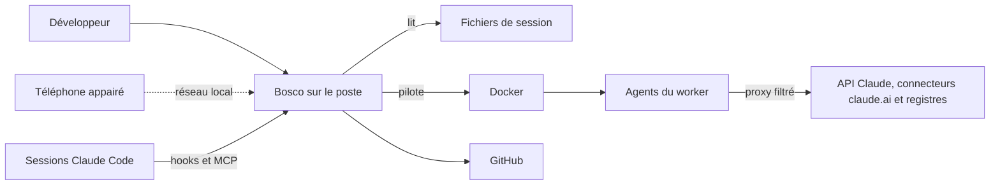
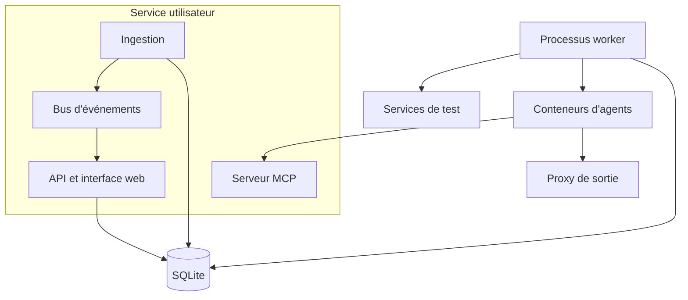
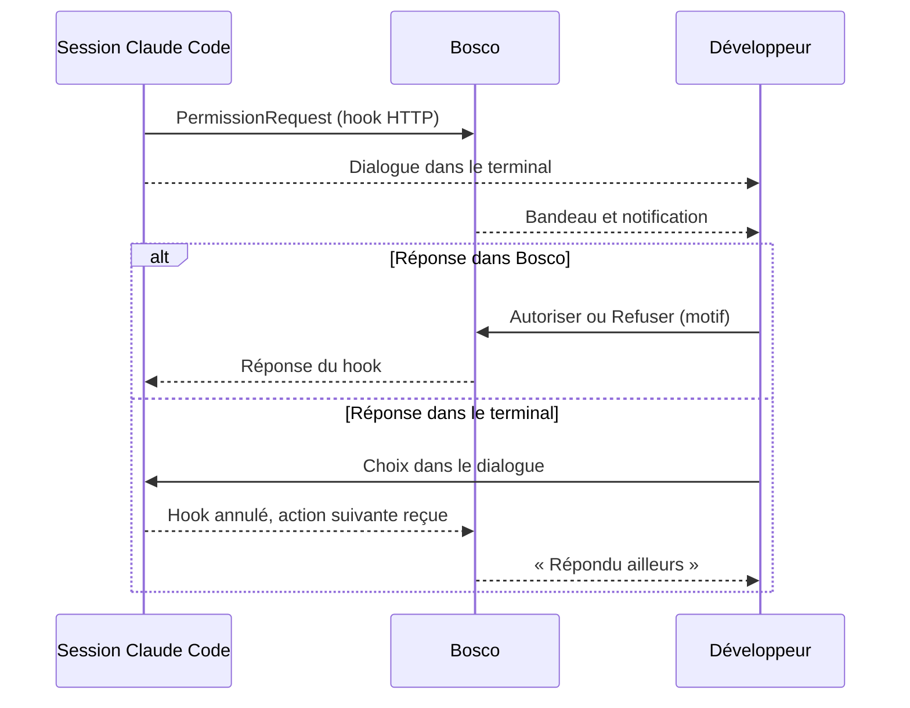
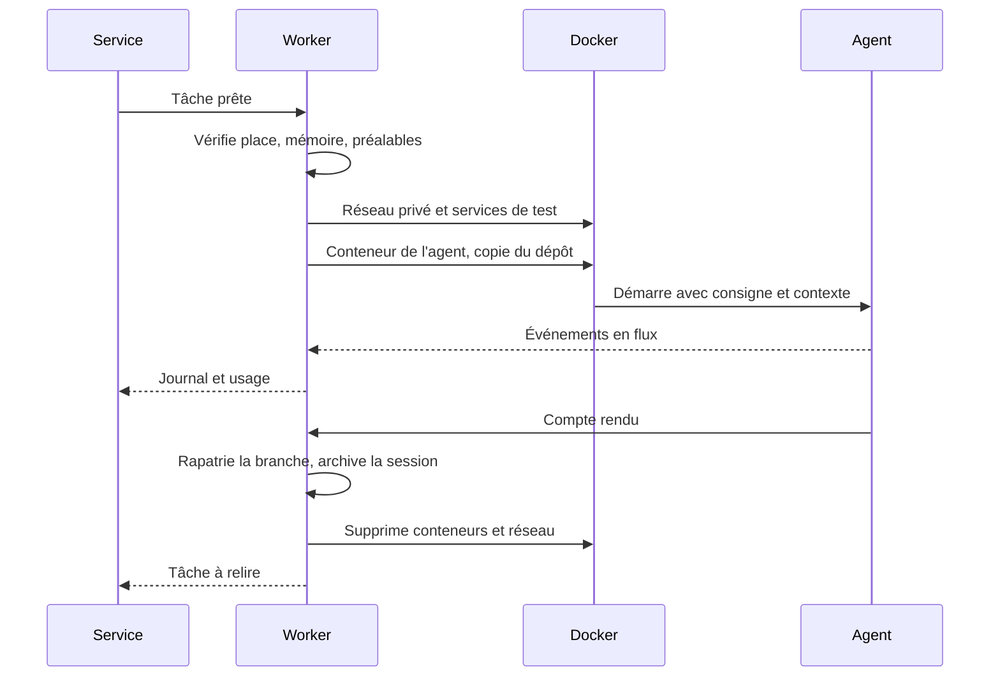
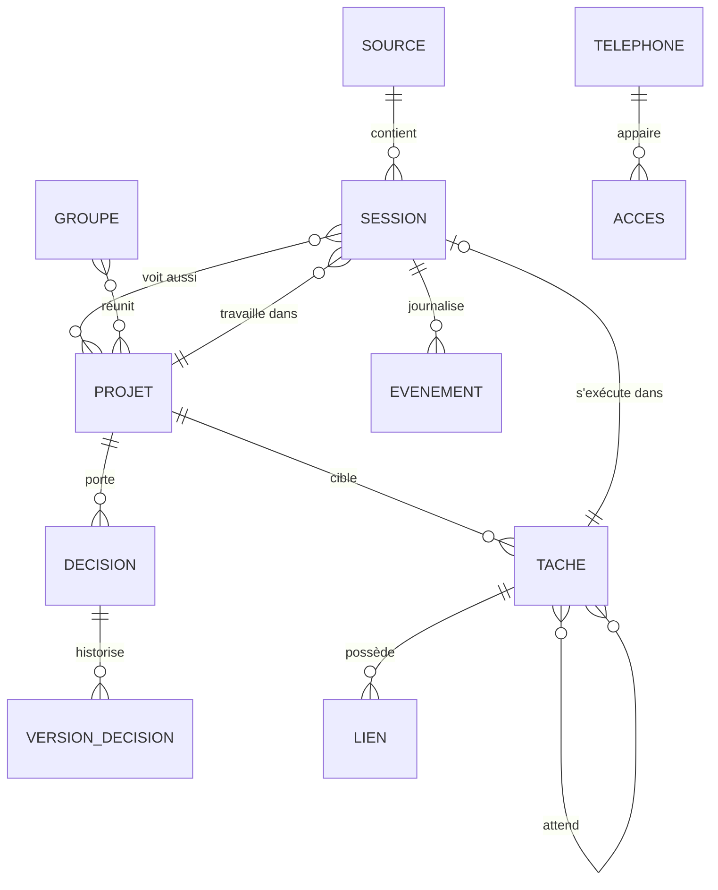

<!-- Généré par export.mjs (skill requirements-doc) depuis sources/60-architecture.md : ne pas modifier ici. -->

# 6. Architecture

## 6.1 Vue d'ensemble

Bosco est une application locale : tout tourne sur le poste. Elle observe les sessions Claude Code, leur répond quand c'est permis, et lance des agents isolés dans Docker.

## 6.2 Composants

Chaque composant suit l'architecture hexagonale (DT-15) : le domaine et ses cas d'usage sont partagés, les composants n'en sont que des adaptateurs. Le service et le worker sont deux processus distincts, qui partagent la même base.

| Composant | Rôle | Lots |
|---|---|---|
| Ingestion | Lit les transcripts, reçoit les hooks, normalise, calcule l'état, copie en base | 1 |
| Bus d'événements | Pousse chaque changement vers les flux SSE | 1 |
| API et interface web | API NestJS (REST, flux SSE), Next.js hébergé dans le même processus, notifications du bureau | 1, 2, 3 |
| Serveur MCP | Tâches pour « Ma session », propositions de décisions | 2, 3 |
| Processus worker | File, dépendances, copie du dépôt, agents, services, rapatriement de branche | 2, 3 |
| Proxy de sortie | Filtre le réseau des agents par nom de domaine | 3 |
| CLI `bosco` | Démarrer, état, `bosco resume` | 1 |

## 6.3 Flux principaux

**Autorisation demandée** ([E2b](lots/sessions.md#e2b), RF-SESS-03). Le dialogue du terminal et le hook démarrent ensemble : la première réponse l'emporte. Comportement vérifié sur Claude Code 2.1.319 dans les deux sens, non documenté.

**Tâche du worker** (E5b, E7a, règle 01 des tâches).

**Découverte d'une session** (RF-SESS-01). L'ingestion surveille les dossiers de chaque profil et reprend chaque fichier à sa dernière position. Les hooks donnent le temps réel ; les transcripts donnent l'historique et rattrapent ce qui a été manqué.

## 6.4 Modèle de données

Règles d'intégrité tirées des specs :

- une session a un seul état (RF-SESS-02), une tâche aussi (règle 02 des tâches) ;
- un événement a un numéro séquentiel et n'est jamais modifié ;
- une dépendance entre tâches ne forme pas de boucle ;
- un projet a un chemin unique ; un groupe a un nom unique et un projet principal tant qu'il a des projets (RF-CONT-19) ;
- une décision acceptée change par une nouvelle version, jamais en place (RF-CONT-11) ;
- une tâche en mode Ma session n'a pas de garde-fous (règle 05 des tâches).

Droits, plafonds et réglages sont stockés par niveau (général, groupe, projet, tâche) et résolus au lancement.

## 6.5 Intégrations externes

| Service | Usage | Mode | Points d'attention |
|---|---|---|---|
| Claude Code | Observation et réponses | Hooks HTTP, transcripts, MCP | Format de transcript interne, à tester à chaque version |
| Claude Agent SDK | Agents du worker | Bibliothèque, abonnement | Limites partagées avec les sessions : le quota de l'abonnement, lu à chaque tour, retient le worker (DT-39) |
| GitHub | Liens enrichis | API, jeton | Rafraîchi toutes les heures |
| GitHub CLI | Branches et PR en brouillon | `git`, `gh` du poste | Absent : seule la validation sans pousser reste |
| Connecteur Atlassian de claude.ai | Lecture des tickets et pages par les agents du worker, si activée (DT-36) | OAuth géré par claude.ai, joint par `mcp-proxy.anthropic.com` ; aucun accès dans Bosco | Absent du compte : la tâche continue sans lui, noté au journal |
| Docker | Agents et services | Socket du poste | Indisponible : les tâches attendent (E5c) |
| Registres npm privés | Paquets des dépôts | Copie du .npmrc du poste dans la tâche (DT-28) | Jeton lisible par l'agent : en lecture seule et de courte durée ; domaines autorisés d'office |

## 6.6 Sécurité applicative

- **Authentification** : aucune sur la boucle locale. Un téléphone s'appaire par code, puis reçoit un jeton révocable (NF-14).
- **Autorisations** : matrice de la partie 2. Une session ou un agent ne peut pas modifier droits, isolation ni décisions acceptées (RF-CONT-02, RF-CONT-09).
- **Hooks** : l'entrée des hooks n'écoute que sur la boucle locale et exige un secret propre à l'installation.
- **Agents du worker** : utilisateur sans droits, capacités retirées, réseau interne, proxy à liste blanche, jeton MCP par tâche révoqué à la fin.
- **Secrets** : stockés hors de la base lisible par les agents, jamais journalisés (NF-15). La copie temporaire de l'accès Claude est lisible par l'agent pendant la tâche (RQ-05).
- **Docker** : le worker pilote Docker, ce qui équivaut à des droits root sur le poste ; il n'expose jamais le socket aux agents.

## 6.7 Conception du domaine

L'architecture hexagonale (DT-15) n'est utile que si le domaine porte vraiment les règles. Cette partie fixe comment le découper et l'écrire ; les règles du code (§7.4) la reprennent pour les agents, et le lint vérifie les frontières (DT-23).

**Contextes.** Tout le code serveur vit dans une seule application, `apps/api`, avec un module par contexte : `src/<contexte>/`, en quatre couches.

- `domain/` : agrégats, objets valeur, événements, erreurs ;
- `application/` : un service par agrégat et `ports.ts` ;
- `infrastructure/` : les adaptateurs des ports (persistance MikroORM, lecture des transcripts, Docker, git, intégrations) ;
- `interface/http/` : contrôleurs, flux en direct, entrée des hooks, schémas de validation.

`<contexte>.module.ts` relie chaque port à son adaptateur, avec les jetons de `<contexte>/tokens.ts`. `src/shared/` est le noyau partagé (erreur de base, horloge, persistance commune), `src/app.module.ts` le point de composition. Le worker (DT-02) est un autre point d'entrée de la même application (`src/main-worker.ts`), lancé dans son propre processus, qui ne charge que les modules dont il a besoin ; la commande `bosco` aussi (`src/cli/main.ts`, déclarée en `bin` du paquet), ce qui lui permet d'appeler directement les cas d'usage (`bosco resume`). Les contrats partagés avec le web (types des vues, nom de l'application) vivent dans `packages/domain`, et nulle part ailleurs.

| Contexte | Agrégats | Règles portées | Lots |
|---|---|---|---|
| `sessions` | Session (avec son journal d'événements) | RF-SESS-01 à RF-SESS-05, RF-SESS-09 à RF-SESS-11 | 1 |
| `devices` | Téléphone appairé | RF-SESS-07 | 1b |
| `tasks` | Tâche | règle 01 des tâches à règle 04 des tâches, règle 06 des tâches à règle 08 des tâches | 2 |
| `policies` | Garde-fous (général, dépôt, tâche), isolation, sortie réseau | règle 05 des tâches, RF-CONT-06 à RF-CONT-09, RF-CONT-12 | 2 et 3 |
| `knowledge` | Décision (avec ses versions), Lien | RF-CONT-01, RF-CONT-02, RF-CONT-04, RF-CONT-05, RF-CONT-10, RF-CONT-11, RF-CONT-15 | 3 |
| `projects` | Projet, Groupe (avec ses instructions) | RF-CONT-16 à RF-CONT-24 | 10 |

Un contexte n'importe jamais les classes d'un autre : quand `tasks` a besoin de savoir qu'une session est close, il déclare un port (`SessionStatus`), que le point de composition (`src/app.module.ts`) branche sur le service de `sessions`.

**Agrégats et invariants.** Un agrégat garantit seul ses règles : on le charge, on appelle une méthode métier, on l'enregistre. Ses invariants se testent sans base ni framework.

| Agrégat | Invariants |
|---|---|
| Session | Un seul état à la fois, et seulement les transitions prévues (RF-SESS-02) ; une seule autorisation en attente, tranchée par la première réponse (RF-SESS-03) ; le journal ne fait que s'allonger, numéroté, jamais modifié ; une reprise n'existe que pour une session close (RF-SESS-09). |
| Tâche | Un seul état parmi les neuf de règle 02 des tâches, par des transitions nommées (`queue`, `block`, `start`, `submitForReview`, `validate`, `reject`, `fail`, `cancel`, `retry`) ; modifiable seulement avant son départ (règle 08 des tâches) ; jamais fusionnée (règle 06 des tâches). |
| Graphe des préalables | Service du domaine, car il couvre plusieurs tâches : pas de boucle, pas de préalable déjà en échec, échec en cascade (règle 03 des tâches), branche de départ selon règle 04 des tâches. |
| Garde-fous | Un niveau inférieur ne peut que resserrer : outils permis et plafond de tours d'une tâche jamais au-delà de son dépôt (règle 05 des tâches) ; figés au lancement d'une tâche. La résolution est une fonction pure du domaine. |
| Décision | Un agent propose, jamais n'accepte ni ne modifie une décision acceptée (RF-CONT-02) ; une décision acceptée change par une nouvelle version avec une note, les précédentes restent lisibles (RF-CONT-11). |
| Groupe | Nom unique ; projets ordonnés, le premier est le principal ; « Tous les projets » contient toujours tous les projets et n'a que des instructions (RF-CONT-19, RF-CONT-20). Remplace le socle (DT-41). |
| Téléphone appairé | Accès désactivé par défaut, appairage par code puis confirmation sur le poste (RF-SESS-07). |

**Objets valeur.** Immuables, comparés par valeur, valides dès leur création : identifiants (`SessionId`, `TaskId`, `DecisionId`), chemin de dépôt, nom de branche (`bosco/t-<n>-<sujet>`), coût estimé (dollars au tarif public, toujours présenté comme une estimation, RF-SESS-05), consommation de tokens (entrée, sortie, cache), budget, plafond de tours, règle d'outil (`Bash (npm test)`), durée. Aucun identifiant ni montant ne circule en `string` ou `number` nu dans le domaine.

**Événements du domaine.** Un agrégat note ce qui s'est passé (`PermissionRequested`, `PermissionAnswered`, `SessionStateChanged`, `TaskReadyForReview`, `TaskFailed`, `DecisionProposed`, `DecisionAccepted`…) ; le service les publie après l'enregistrement, par le port `EventPublisher`. Le flux SSE (DT-06), les notifications du bureau et le déblocage des tâches suivantes s'y abonnent dans les adaptateurs : le domaine ne connaît ni SSE, ni notifications. À ne pas confondre avec le journal d'événements d'une session, qui est une donnée lue dans les transcripts.

**Ports.** Déclarés par l'application qui en a besoin, nommés par ce qu'ils offrent : dépôts (`SessionRepository`, `TaskRepository`, `DecisionRepository`), `TranscriptReader`, `ContainerRunner`, `GitGateway` (git et GitHub CLI), `LinkPreviewer` (GitHub ; Jira et Confluence reconnus à leur adresse, sans lecture), `Notifier`, `EventPublisher`, `Clock`, `IdGenerator`. Chaque port a un adaptateur réel dans `apps/*/src/adapters/out` et un adaptateur en mémoire pour les tests du domaine.

**Cas d'usage et nommage.** Un service par agrégat (`session.service.ts`), une méthode par intention (`askPermission`, `answerPermission`, `queueTask`, `validateTask`, `acceptDecision`), jamais `execute`, `handle` ni `run`. `get…` lève une erreur si l'objet manque, `find…` renvoie `null` ; `list…`, `count…`, `has…`. Une méthode de contrôleur porte le nom de la méthode du service qu'elle appelle ; une dépendance injectée porte le nom de son type.

**Erreurs.** Une erreur du domaine hérite de l'erreur de base de son contexte et porte un code stable en camelCase (`permissionAlreadyPending`, `taskNotFound`) et un message en anglais. L'adaptateur HTTP les traduit en statut et en corps `{ statusCode, code, message }` ; l'interface traduit le code et n'affiche jamais le message. Un 5xx ne renvoie aucun détail interne.

**Assemblage.** Chaque `<contexte>.module.ts` relie ses ports à leurs adaptateurs (fabriques `useFactory` et jetons `Symbol`), avec des remplacements possibles pour les tests ; `src/app.module.ts` assemble les contextes et câble ce qui les croise. Le mapping MikroORM vit dans les adaptateurs (`EntitySchema` ou `defineEntity`, DT-18) : les classes du domaine restent sans décorateur.

## 6.8 Anti-patterns à éviter

| Anti-pattern | À quoi on le reconnaît | À faire |
|---|---|---|
| Domaine anémique | Classes à propriétés publiques modifiées par les services ; règles dans les cas d'usage | Méthodes métier sur l'agrégat (`session.askPermission(at)`) qui protègent ses invariants |
| Framework dans le domaine | Import de `@nestjs/*`, `@mikro-orm/*`, `rxjs`, `node:fs`… dans `domain/` ou `application/` ; décorateurs sur les entités | Un port dans l'application, l'adaptateur dans `infrastructure/` ; refusé par le lint |
| Logique dans un adaptateur | Règle métier dans un contrôleur, le flux SSE, un hook ou un adaptateur de dépôt | L'adaptateur traduit et délègue au cas d'usage |
| Fuite de l'ORM | Un dépôt renvoie une entité MikroORM, un `QueryBuilder` ou une ligne brute | Le dépôt renvoie des objets du domaine |
| Temps et hasard implicites | `new Date()`, `Date.now()`, `randomUUID()` dans le domaine | Ports `Clock` et `IdGenerator`, horloge fixe dans les tests |
| Obsession des primitifs | `sessionId: string`, `cost: number` qui traversent les couches | Objets valeur |
| Couplage entre contextes | `tasks` importe la classe `Session` | Un port déclaré par `tasks`, branché à l'assemblage ; refusé par le lint |
| Cas d'usage générique | `execute(command)`, `handle(input)`, un service fourre-tout | Une méthode par intention, un service par agrégat |
| Paquet partagé sans second utilisateur | `packages/utils` pour une seule application | Le code reste dans l'application tant qu'il n'a qu'un utilisateur |
| Tests en double | Un test unitaire qui rejoue un scénario Gherkin | Un parcours se teste une fois, en scénario ; Vitest couvre ce que les scénarios n'atteignent pas (temps, cas rares, invariants) |
| Cérémonie DDD | Event sourcing, CQRS, bus de commandes, dépôt générique, couches de conversion sans règle | Bosco est un outil de poste : SQLite, agrégats simples, événements publiés après l'enregistrement |

## 6.9 Décisions d'architecture

**DT-01 · Dépôt dédié.** Bosco vit dans son propre dépôt, avec les specs. Écarté : rester avec les POC.

**DT-02 · Service et worker séparés.** Redémarrer l'interface ne coupe pas les tâches (NF-07). Deux processus, coordonnés par la base, lancés depuis la même application serveur (`main.ts` et `main-worker.ts`, DT-15). Écarté : un seul processus.

**DT-03 · Worker écrit à neuf.** Le code est écrit pour ce modèle de données, sans reprise. Coût : lot 2 plus long.

**DT-04 · SQLite local.** Mode WAL pour deux processus, FTS5 pour la recherche. Aucun service à installer. Écarté : base serveur, disproportionnée sur un poste.

**DT-05 · Hooks et transcripts.** Les hooks HTTP donnent le temps réel, les transcripts l'historique. Claude Code [précise](https://code.claude.com/docs/en/sessions.md) que leur format est interne : la lecture tolère l'inconnu (NF-08).

**DT-06 · SSE et bus en mémoire.** Un flux global et un flux par session, poussés à l'ingestion. Chaque flux commence par un instantané de l'état, puis envoie les changements, sur le même canal : la lecture de l'instantané et l'abonnement ont lieu dans le même tour de boucle, si bien qu'aucun changement ne peut se perdre entre les deux. L'essai de DT-21 l'a montré : avec une lecture REST séparée du flux, un changement reçu pendant la première lecture était perdu (2 échecs sur 12 passages d'un même scénario) ; avec l'instantané, 24 passages sur 24. Une reconnexion reçoit un nouvel instantané. Écartés : interrogation périodique (coûteuse), WebSocket (le trafic va surtout du serveur au client).

**DT-07 · Autorisations par hook `PermissionRequest`.** Fondé sur un comportement testé mais non documenté, d'où NF-09 et RQ-01.

**DT-08 · Conteneur jetable et services de test.** Docker natif, sans publication de ports, donc sans conflit entre tâches. Écartés : bac à sable bubblewrap (bloqué par AppArmor sur Ubuntu 24.04, sans accès aux services), sans isolation, Sysbox (inutile : un seul dépôt personnel lance Docker dans ses tests).

**DT-09 · Abonnement Claude pour le worker.** Décision du porteur du projet. Écarté : clé d'API. Conséquence : limites partagées avec les sessions (RQ-04).

**DT-10 · Téléphone sur le réseau local.** Certificat créé par Bosco, avertissement accepté une fois, appairage par code, sans VPN. Conséquence : pas d'accès hors réseau, pas de notifications sur le téléphone.

**DT-07 (précision).** Le hook attend 10 minutes, sa valeur par défaut. Au-delà, les boutons disparaissent de Bosco et le dialogue reste dans le terminal.

**DT-11 · Pull requests par `git` et `gh`.** Aucun jeton supplémentaire : Bosco utilise ceux du poste.

**DT-12 · API en NestJS.** Choix du porteur du projet : c'est la stack des API existantes. Le serveur MCP et le worker utilisent la même structure de modules. Conséquence : plus de mémoire au repos qu'avec Fastify seul (NF-04).

**DT-13 · Web en Next.js, hébergé par NestJS.** Choix du porteur du projet. NestJS sert Next.js dans son propre processus (serveur personnalisé) : un seul service et un seul port, sans proxy, avec le certificat du téléphone géré à un seul endroit. Les flux SSE sont servis par NestJS. Vérifié par l'essai de DT-21 : Next.js 16.4 servi par NestJS 12.4 avec l'adaptateur Fastify, sur un seul port, les routes de l'API passant avant celles de Next.js ; `next` est un module CommonJS, son export par défaut se récupère explicitement sous `nodenext`. Écartés : Next.js en processus séparé (un service de plus à superviser), export statique (les pages à identifiant dynamique, comme une session, s'y prêtent mal).

**DT-14 · MikroORM.** Choix du porteur du projet. Pilote SQLite, unité de travail, migrations versionnées. La recherche plein texte (FTS5) passe par des requêtes natives dans l'adaptateur. Écartés : Drizzle, Prisma, TypeORM.

**DT-15 · Architecture hexagonale par modules.** Choix du porteur du projet. Une seule application serveur, `apps/api`, avec un module par contexte métier et ses quatre couches (`domain`, `application`, `infrastructure`, `interface/http`, §6.7) ; le domaine et l'application restent sans dépendance technique ; NestJS, MikroORM, Docker et les intégrations sont des adaptateurs derrière des ports. Conséquence : un peu plus de code d'assemblage, en échange de tests du domaine rapides et sans infrastructure. Écarté : un paquet `packages/core` pour le domaine, partagé par l'API et le worker (un paquet à compiler avant l'API, trois couches réparties entre deux dossiers, pour un worker qui peut être un second point d'entrée de la même application).

**DT-16 · TypeScript 6 et ESM.** Choix du porteur du projet. TypeScript 6.0, dernière version de la branche 6, pour tout le code, en modules ESM ; les tests passent par Vitest, sans Jest. NestJS et MikroORM s'appuient sur les métadonnées des décorateurs (voir DT-18). Le passage à TypeScript 7 est prévu dès que l'outillage le permet (DT-20).

**DT-17 · Données et état côté web.** Choix du porteur du projet. TanStack Query porte tout ce qui vient du serveur : le cache des vues en direct est rempli par le flux (instantané puis changements, DT-06), celui des autres écrans par l'API REST ; il n'y a pas de second état à synchroniser. Zustand ne garde que l'état de l'interface (regroupement par dépôt ou par état, filtres, panneaux ouverts) ; le regroupement choisi est conservé d'une visite à l'autre (RF-SESS-06). Les formulaires passent par React Hook Form et son résolveur zod : valeurs, erreurs par champ et soumission, et les erreurs renvoyées par l'API se posent sur leur champ. Écartés : Redux (lourd pour ce besoin), Context React seul (rendus en cascade sur un écran mis à jour en direct), formulaires tenus à la main dans l'état local.

**DT-18 · TypeScript 6 seul pour compiler et vérifier.** Choix du porteur du projet : un seul compilateur à régler. `tsc -b` compile l'application serveur (service, worker, commande `bosco`) et les paquets en ESM (`module` et `moduleResolution` à `nodenext`), avec `experimentalDecorators`, `emitDecoratorMetadata` et un `rootDir` explicite. Next.js compile lui-même le web et vérifie ses types avec TypeScript 6 ; il exige `@types/node`. Vitest transforme les tests avec son outil intégré : les décorateurs « legacy » et leurs métadonnées y sont réglés explicitement dans `vitest.config` (`oxc.decorator`), sans dépendre d'un réglage par défaut. Pour garder le passage à TypeScript 7 simple (DT-20), la compilation passe par `tsc` et non par la CLI NestJS, et le mapping MikroORM est explicite (`EntitySchema` ou `defineEntity`), sans lecture des types. Essai du 07/11/2026 dans un monorepo pnpm 12.18, tout vert, avec Node 26.13 LTS, TypeScript 6.0.3, NestJS 12.4.0, MikroORM 7.2.8 sur SQLite, Vitest 5.1.0, Next.js 16.4.5, React 19.3, TanStack Query 5.107 et Zustand 5.1 : vérification de types, injection NestJS et lecture d'une entité du domaine par MikroORM après compilation par `tsc` et sous Vitest, build Next.js qui détecte bien une erreur de type. La même configuration passe aussi `tsc --noEmit` de TypeScript 7.0.2, pour l'API comme pour le web.

**DT-19 · ESLint et Prettier.** Choix du porteur du projet, dernières versions : ESLint 10 en configuration plate, typescript-eslint 8.72 avec règles typées (`recommendedTypeChecked`, `projectService`), `@next/eslint-plugin-next` pour le web (réglage `settings.next.rootDir` sur `apps/web` dans le monorepo), Prettier 3.9 et `eslint-config-prettier` pour qu'ESLint ne juge pas la mise en forme. Essai du 07/11/2026 avec TypeScript 6.0.3 : ESLint passe sur le code propre, signale une promesse non attendue (règle typée) et une balise `` (règle Next.js) ; Prettier signale un fichier mal formé et accepte le reste. Écartés : oxlint, Biome.

**DT-20 · Passage à TypeScript 7.** Prévu, pas encore possible : TypeScript 7 n'a plus l'API JavaScript du compilateur, et typescript-eslint, qui en dépend, n'accepte TypeScript que jusqu'à la 6.0 (8.72.1, 26/10/2026). La nouvelle API arrive avec TypeScript 7.1 (beta du 20/10/2026) et sa prise en charge par typescript-eslint est en cours. Déclencheur : une version stable de typescript-eslint qui accepte TypeScript 7.1, vérifiée au démarrage de chaque lot. D'ici là, le projet compile et se vérifie en TypeScript 6 seul ; la CI ne lance pas TypeScript 7. Passage : monter `typescript`, puis rejouer typage, tests, ESLint et build Next.js ; c'est une tâche à part, hors des lots, estimée à moins d'une demi-journée de relecture.

**DT-21 · Stratégie de tests.** Choix du porteur du projet, après un essai complet le 07/11/2026.

- **Deux outils, un rôle chacun.** Vitest teste le domaine, les cas d'usage et les adaptateurs (MikroORM sur SQLite, lecture des transcripts, Docker). playwright-bdd 9.2, sur Playwright 1.65, joue les scénarios Gherkin.
- **Deux suites séparées, lancées l'une sans l'autre.** `e2e/api`, sans navigateur, et `e2e/web`, en deux groupes : `desktop` et `mobile` (scénarios tagués `@mobile`, profil Pixel 7). Chaque suite a sa configuration, ses phrases, ses données d'exemple, ses enregistrements et son rapport Cucumber. Elles ne partagent que le lancement de Bosco (`e2e/shared`) et le module d'enregistrement.
- **Deux styles de scénarios.** Ceux de l'API sont techniques et en anglais : route, code de réponse, JSON, événement du flux. Des phrases génériques les rendent presque gratuits à écrire : requête HTTP, requête restée en attente (hook), événement attendu sur le flux, capture d'une réponse avec des champs masqués, transcript d'exemple. Ceux du web sont des parcours en français, avec des phrases d'interface par rôle accessible (« je clique sur le bouton « Autoriser » »), les textes entre guillemets français, et la phrase « la page est accessible » (axe, WCAG 2.2 AA). La langue est celle de la suite. L'anglais, langue par défaut de Gherkin, ne demande rien. Les fichiers du web commencent par `# language: fr`, car le plugin Prettier et l'extension Cucumber de l'éditeur ne lisent la langue que là.
- **Une instance de Bosco par processus de test**, avec son port, son dossier Claude Code et sa base, remise à zéro entre deux scénarios par une route réservée aux tests (absente hors mode test). Les scénarios tournent en parallèle, sans données partagées.
- **Enregistrer, rejouer, nettoyer.** Un module du dépôt, d'environ 200 lignes, s'appuie sur `Agent` et `MockAgent` d'undici. Il est chargé par `node --import` dans le processus testé seulement : le code de l'application garde `fetch`. Modes : `replay` (par défaut et en CI : tout vient des fichiers, une requête inconnue échoue), `record` (rejoue l'existant, enregistre ce qui manque, sur le poste avec les vrais accès), `update` (réenregistre tout), `clean` (supprime ce qu'aucun processus de test n'a utilisé, rapports réunis à la fin). Un fichier JSON lisible par réponse, rangé par hôte dans le dossier de la suite ; le corps de la requête choisit la réponse ; les réponses successives se rejouent dans l'ordre ; en-têtes en liste blanche et secrets masqués à l'enregistrement, puis recherchés en CI. Dans le navigateur, les écrans sans temps réel rejouent les réponses de l'API de Bosco par `page.route`, avec le même format. Les transcripts et requêtes de hooks Claude Code suivent la même logique : enregistrés depuis de vraies sessions, anonymisés, rangés par version de Claude Code.
- **Qualité des `.feature`.** `prettier-plugin-gherkin` 4.0 les met en forme (indentation, tableaux alignés) dans le `prettier --check` habituel. Un contrôle du dépôt, d'environ 60 lignes sur le parseur officiel `@cucumber/gherkin`, vérifie le sens : langue de la suite (en-tête `# language: fr` pour le web, aucun pour l'API), tag de critère `@CA-…`, `@RF-…` ou `@NF-…` sur chaque scénario ou sa fonctionnalité, une action et un résultat par scénario, contexte seul dans `Contexte`, 15 scénarios au plus par fichier, noms uniques, description de la fonctionnalité.
- **Ce qui est versionné** : les `.feature`, les phrases, les captures (dans un dossier `__snapshots__` à côté des features, sans suffixe de plateforme) et les enregistrements. **Ce qui ne l'est pas** : `.features-gen/`, généré par `bddgen` à chaque lancement, les rapports et `test-results/`.
- **Tests réels** tagués `@reel`, exclus par défaut et lancés à la demande sur le poste : NF-09 (vraie session Claude Code), NF-11 (évasion d'un vrai conteneur), NF-12 (arrêt brutal du worker).
- **Répartition des critères.** Une règle du domaine se teste avec Vitest ; un contrat d'API (route, code, JSON, événement, hook) par un scénario `api` ; un parcours ou un état visible par un scénario web. La répartition critère par critère se fait en écrivant les tests, et `trace.mjs` la mesure : il lit les tags des `.feature` comme les noms des tests Vitest.
- **Points relevés par l'essai.** Une phrase ne se déclare qu'une fois : playwright-bdd ne distingue pas « Étant donné », « Quand » et « Alors ». Le plugin Prettier des `.feature` analyse en anglais tout fichier sans en-tête de langue. Un enregistrement manquant échoue avec un message d'undici peu parlant : le module devra nommer la requête et la commande à lancer. Deux enregistrements de la même requête se masquent l'un l'autre, et le nettoyage peut garder la copie plutôt que l'original : le module devra refuser les doublons au chargement.
- **Résultat de l'essai** (Node 26.13, TypeScript 6.0.3, pnpm 12.18) : 9 scénarios et 6 tests du module d'enregistrement. Sur 5 répétitions, chaque suite lancée seule : API, 25 passages sur 25 en 4,1 s ; web (4 scénarios, dont un sur mobile), 20 sur 20 en 4,3 s. Rejeu sans réseau, enregistrement contre la vraie API GitHub, nettoyage dans chaque suite du fichier devenu inutile ; 7 fautes relevées sur un fichier fautif ; une vraie violation d'accessibilité trouvée par axe (titre de page manquant) ; et la perte d'événement corrigée par DT-06.

Écartés : une configuration Playwright commune à l'API et au web (couplage inutile entre deux suites qui ne tournent pas ensemble) ; Cucumber sous Vitest pour l'API (deux exécuteurs Gherkin avec le web) ; gherklin (publié en TypeScript non compilé, il exige tsx, et ses règles génériques relèvent de la mise en forme, déjà assurée par Prettier) ; `SnapshotAgent` d'undici (expérimental, corps enregistrés en base64, ce qui cache les secrets aux contrôles) ; rejeu par fichier HAR de Playwright (il compare l'URL avec son port, alors que chaque processus de test a le sien, et ne signale pas les réponses inutilisées).

**DT-22 · Turborepo sur pnpm.** Choix du porteur du projet. Turborepo 2.11 (2.11.10) orchestre les tâches du monorepo pnpm : `build`, `typecheck`, `lint`, `test`, `lint:features`, `e2e:api` et `e2e:web`. Il ne remplace aucun outil : `tsc -b` compile toujours (DT-18), Next.js construit le web, Vitest et playwright-bdd testent.

- **Ordre et parallélisme.** Chaque tâche dépend des `build` des paquets dont elle dépend (`dependsOn: ["^build"]`) ; le reste tourne en parallèle. Le paquet des scénarios déclare l'API et le web en dépendances (`workspace:*`), pour qu'ils soient construits avant.
- **Cache local.** Une tâche dont les entrées n'ont pas changé rejoue son résultat et ses journaux sans s'exécuter. Les entrées suivent git : le `.gitignore` doit exclure tout ce qui est généré (`dist/`, `.next/`, `next-env.d.ts`, `*.tsbuildinfo`, `.turbo/`, `.features-gen/`, rapports, `test-results/`), sinon le cache ne tient jamais. Sorties déclarées : `dist/**`, `.next/**` sans `.next/cache`, rapports des suites.
- **Deux suites, deux entrées.** Les entrées de `e2e:api` excluent le dossier du web, et inversement : modifier un scénario du web ne relance pas la suite de l'API. Le dossier commun (`e2e/shared`) relance les deux. Le mode d'enregistrement (`BOSCO_REPLAY`) fait partie de l'empreinte.
- **Enregistrer et nettoyer hors cache.** Les modes `record`, `update` et `clean` écrivent des fichiers : leurs commandes passent `--force` (`pnpm e2e:api:record`, `pnpm e2e:web:record`, `pnpm e2e:clean`).
- **CI.** Les étapes passent par `turbo run` ; le dossier de cache de Turborepo est conservé entre deux exécutions par le cache de GitHub Actions.
- **Essai du 07/11/2026** (Node 26.13, pnpm 12.18) : premier lancement de `e2e:api` en 4 s (API, web, scénarios) ; second lancement entièrement en cache, en 10 ms ; `e2e:web` réutilise les builds déjà en cache ; une modification d'un scénario web ne relance que `e2e:web` ; une modification du code de l'API relance son build et `e2e:api`, pas celui du web. Sans `.gitignore`, chaque lancement reconstruisait tout.

Écartés : cache distant (un seul poste, la CI se suffit du cache local), Nx (plus lourd à régler pour cinq paquets), scripts pnpm seuls (`pnpm -r` ne sait ni éviter une tâche inchangée ni rejouer un résultat).

**DT-23 · Qualité du code partagée et frontières vérifiées.** Choix du porteur du projet. Un paquet `packages/configs` porte toutes les configurations (§7.3) : TypeScript, ESLint, Vitest et Prettier. Chaque paquet les étend en quelques lignes, et aucune règle ne se désactive dans le code. Les frontières de l'architecture hexagonale (§6.7) sont des règles ESLint de l'application serveur (`eslint/nest`), et non une convention écrite.

- **Essai du 07/11/2026** (ESLint 10.14, typescript-eslint 8.72.1, eslint-plugin-boundaries 7.4.2, TypeScript 6.0.3) : un domaine à deux contextes passe le lint, le typage et ses tests. Cinq violations écrites exprès sont refusées, chacune avec un message qui dit quoi faire : `@mikro-orm/core` dans le domaine, domaine qui importe l'application, contexte qui importe un autre contexte, `node:fs` dans l'application, fichier hors kebab-case. Sur le code de l'essai, écrit sans ces règles, le lint a relevé 46 défauts : 25 corrigés automatiquement, 21 à la main (expressions régulières à risque, valeurs `any`, méthode détachée de son objet, comparaison toujours fausse). Les 14 tâches `lint`, `typecheck`, `test` et `build` et les deux suites e2e passent ensuite.
- **Points relevés** :
  - `eslint-plugin-jsx-a11y` (6.10.2, octobre 2024) déclare ESLint 9 au plus. Il fonctionne avec ESLint 10, mais pnpm le signale (RQ-11).
  - Les motifs ignorés doivent commencer par `**/`, sinon les dossiers générés des sous-dossiers (`api/.features-gen`) sont analysés.
  - Le greffon Gherkin de Prettier se résout depuis `packages/configs`, pour que la racine n'ait pas à le déclarer.
  - Une fixture Playwright sans dépendance (`async ({}, use)`) demande l'option `allowObjectPatternsAsParameters` de `no-empty-pattern`, plutôt qu'un commentaire de désactivation.

Écartés : `dependency-cruiser` (un outil de plus, alors qu'ESLint lit déjà les imports), Biome et oxlint (DT-19), une configuration par application (des règles qui dérivent d'une application à l'autre).

**DT-24 · Règles pour les agents dans le dépôt.** Choix du porteur du projet. Claude Code écrit le code : les conventions sont des fichiers du dépôt, qu'il charge seul (§7.4). On y trouve `AGENTS.md` (lié à `CLAUDE.md`), des règles par zone dans `.claude/rules/` (en-tête `paths:`), un sous-agent qui confronte le code aux specs en fin de lot, et une liste de contrôles avant de rendre la main. Ce qu'une règle peut vérifier passe par le lint ; le texte garde ce que le lint ne voit pas, comme le nommage par intention, les anti-patterns de §6.8 ou ce que teste chaque niveau. Écarté : une documentation de conventions hors du dépôt, que l'agent ne lirait pas.

**DT-25 · daisyUI sur les tokens.** Choix du porteur du projet. Les maquettes et l'application emploient les classes de daisyUI 5.7.50 (`btn btn-primary`, `badge`, `input`, `toggle`, `modal`…), plutôt que des suites d'utilitaires qui les imitent. Un thème daisyUI pointé sur les tokens des specs règle leur rendu : l'identité « Atelier clair » ne change pas, et une couleur se change toujours dans les tokens, sans `data-theme` ni thème intégré. Les composants React (shadcn/ui sur Radix, pour les comportements clavier et l'accessibilité) posent ces classes par leurs variantes ; le skill `design-system` met le tout en place au lot 0 (`scaffold.mjs --specs`, copie des tokens par `tokens.mjs`), avec Storybook et le lint des classes. Les specs ont été migrées le 07/11/2026 : 180 boutons, 143 badges, 31 champs, 12 cases, 10 interrupteurs, 10 tableaux, 8 fenêtres, sans débordement relevé. shadcn/ui sur Radix et Storybook validés par le porteur du projet le 07/11/2026. Écartés : composants de daisyUI seuls (pas de gestion du clavier ni du focus des fenêtres et menus), classes maison.

**DT-26 · Fil complet d'une session.** Choix du porteur du projet (08/11/2026). Le détail d'une session (E2a) montre sa conversation complète, lue à la demande dans son transcript : le journal enregistré garde l'essentiel (recherche, résumé), le transcript reste la source du détail et n'est jamais recopié. La lecture tolère l'inconnu (DT-05, NF-08) ; une très longue session n'est lue que par sa fin (8 Mo), puis seules les lignes ajoutées sont relues ; un transcript effacé par Claude Code laisse le fil résumé du journal. Les sous-agents sont lus dans leur propre transcript (`<session>/subagents/`), rattachés à l'appel qui les a lancés, et le plan de l'agent est reconstitué depuis ses outils (TodoWrite, TaskCreate, TaskUpdate). Le rendu suit les patterns d'AI Elements de shadcn/ui (Reasoning, Tool, Terminal, Test Results, Stack Trace, Chain of Thought, Subagent, Queue, Sources), assemblés sur les composants `trace`, `code-block`, `message` et `bubble` rangés sous les classes du projet (DT-25) ; les réponses en Markdown passent par Streamdown, le code par Shiki (thèmes GitHub à contraste élevé, AA sur les lignes de diff ; commande d'un terminal en shell, sortie en ANSI).

**DT-27 · Dépôts découverts.** Choix du porteur du projet (08/11/2026). Le dépôt d'une session se calcule à l'affichage, d'après la racine git de son dossier de travail notée à la lecture du transcript et les réglages des dépôts (E4d) : dépôts git seulement, worktrees rattachés à leur dépôt d'origine (lu dans le fichier `.git` du worktree), dossiers de dépôts, dossiers exclus (`/tmp` par défaut) et dépôts masqués. Un réglage changé vaut donc aussitôt, sans relire l'historique. Les réglages vivent dans la table des réglages du poste et ne s'écrivent que depuis le poste. Les tâches et le contexte ne proposent que les dépôts git affichés, les plus récents d'abord. Écarté : un dépôt figé à la lecture du transcript, qu'un changement de réglage obligerait à relire.

**DT-28 · Secrets des tâches du worker.** Choix du porteur du projet (08/11/2026). Chaque tâche reçoit, dans son dossier personnel temporaire, une copie de l'accès à l'abonnement Claude du profil choisi dans E11b (parmi les profils surveillés qui ont un accès ; la configuration en donne un par défaut, DT-09) et une copie en lecture seule du fichier .npmrc choisi (`~/.npmrc` par défaut), supprimées à la fin. Les domaines des registres de ce fichier sont autorisés d'office ; ses jetons ne sont jamais affichés ni journalisés, mais l'agent peut les lire : le registre doit donner un jeton en lecture seule et de courte durée. Écartés : un relais de registre sur le réseau de la tâche, qui aurait caché le jeton mais demandait de réécrire le protocole des registres ; un jeton Bosco propre à la tâche, l'agent recevant son contexte au lancement et proposant ses décisions par fichier.

**DT-29 · Comptes par dépôt.** Choix du porteur du projet (08/11/2026). Un dépôt peut avoir son abonnement Claude et son compte GitHub (E8a), sinon il prend ceux par défaut (E11b). Bosco agit avec le compte GitHub choisi en passant son jeton à la commande (`GH_TOKEN`, lu par `gh auth token --user`), le temps de la commande : le compte actif de GitHub CLI ne change pas et aucun jeton n'est gardé. La branche part alors en HTTPS, avec l'aide aux identifiants de GitHub CLI, car la clé SSH du poste désignerait un autre compte. Sans compte choisi, rien ne change : le compte actif et le dépôt distant tels quels. Écarté : `gh auth switch`, qui changerait le compte actif pour les sessions du poste.

**DT-30 · Notifications.** Choix du porteur du projet (08/11/2026). Chaque événement (autorisation demandée par le hook, question AskUserQuestion lue dans le transcript, fin de tour du hook Stop avec la durée depuis la dernière demande, fin de session, tâche du worker à relire ou en échec) passe par une règle du domaine qui dit, selon les réglages (E15b), s'il devient une notification et de quel type. La notification est gardée 7 jours dans sa table (centre de notifications, E15a), poussée sur le flux en direct, puis montrée par `notify-send` (icône de Bosco, priorité haute pour une question, remplacement par session, action « Ouvrir » qui lance `xdg-open` vers Bosco), ou en message bref quand l'onglet du poste se dit au premier plan (signal toutes les 15 s, valable 30 s, refusé depuis le téléphone). Une fin de tour qui finit par une question se repère à son point d'interrogation final : une heuristique assumée. Écartés : une notification par l'API Notification du navigateur (rien sans onglet ouvert) ; un nouveau hook pour AskUserQuestion, qui aurait demandé de réinstaller le suivi en direct.

**DT-31 · Sessions pilotées par Bosco.** Choix du porteur du projet (08/11/2026). Bosco lance un tour par processus : `claude -p` en flux JSON en entrée et en sortie, dans le dossier du dépôt, avec le dossier de configuration du profil, `--resume` pour une session existante (même identifiant, même conversation) et `--permission-prompt-tool stdio`, si bien que les autorisations et les questions de l'agent (AskUserQuestion) arrivent à Bosco par le protocole de contrôle et y repartent avec la réponse ; « Arrêter » envoie une interruption. Le mode d'autorisations, le modèle et l'effort se passent à chaque tour. Entre deux tours, aucun processus ne tourne : la session est close et se reprend dans un terminal comme dans Bosco ; une session ouverte dans un terminal (registre des sessions de Claude Code) ne reçoit rien. Les hooks du suivi en direct se déclenchent aussi pour ces tours : pendant un tour piloté, celui des autorisations ne répond rien, Bosco répondant par le protocole de contrôle. L'éditeur de message est un éditeur riche avec mentions (Tiptap), qui produit du texte simple : un fichier mentionné devient `@chemin`, une commande `/nom`. Vérifié sur Claude Code 2.1.319. Écartés : injecter des messages dans une session ouverte dans un terminal (aucune voie documentée ; le canal de Bosco, en aperçu de recherche, fera l'objet d'un lot suivant) ; garder un processus vivant entre deux tours (processus orphelins, reprise impossible dans un terminal).

**DT-32 · Canal de Bosco.** Choix du porteur du projet (08/11/2026). Bosco fournit un serveur de canal de Claude Code (« channels », aperçu de recherche) : la commande `bosco channel`, un serveur MCP sur l'entrée et la sortie standard qui déclare la capacité `claude/channel`. Il s'installe par profil avec `claude mcp add-json --scope user bosco-channel` (le nom `bosco` est celui du serveur MCP de Ma session), et une session lancée avec `--dangerously-load-development-channels server:bosco-channel` le démarre. Le serveur lit l'identifiant de sa session (`CLAUDE_CODE_SESSION_ID`) et suit chez Bosco un flux SSE réservé au poste et protégé par le secret de l'installation ; chaque message écrit dans Bosco devient une notification `notifications/claude/channel`, que Claude Code injecte dans la session et écrit dans le transcript comme une demande venue du canal (Bosco l'affiche « depuis Bosco »). Texte seulement ; les autorisations restent au suivi en direct (pas de relais des autorisations par le canal). Limites assumées : avertissement à confirmer à chaque lancement, canaux désactivables par une organisation Team ou Enterprise, protocole à revérifier à chaque version (vérifié sur 2.1.319). Écartés : un serveur MCP HTTP (le canal passe par l'entrée standard) ; écrire dans le terminal par une autre voie (aucune documentée).

**DT-33 · Applications du poste et Android.** Choix du porteur du projet (08/11/2026). Deux coquilles fines autour de l'interface existante, sans écran propre : une application du poste (Electron, Linux), facultative, lancée depuis le dépôt comme le service ou installée par un paquet .deb, qui lance le service Bosco comme processus enfant (Node du poste) ou se relie à un service qui tourne déjà, affiche l'interface dans sa fenêtre, tient l'icône de la barre système (compte des sessions qui t'attendent, lu sur le flux en direct) et montre les notifications en natif (le service n'envoie alors plus `notify-send`) ; une application Android (Expo, React Native) qui montre l'interface téléphone dans une vue web, ne fait confiance qu'au certificat dont le QR code d'appairage porte l'empreinte, garde l'accès de l'appareil dans le trousseau, et notifie localement tant qu'elle est ouverte ou, en option, connectée en arrière-plan par un service au premier plan. Rien ne quitte le réseau local : pas de service de push. Bosco se lance toujours comme avant (service et navigateur), macOS compris. Le paquet .deb (electron-builder, `make desktop-package`, 09/11/2026) installe l'application dans `/opt/Bosco` avec le service construit, ses dépendances de production, l'interface et le Node 26 qui l'a construit (le moteur SQLite lui correspond) : rien d'autre à installer ; son installation configure le bac à sable d'Electron (profil AppArmor sur Ubuntu 24.04 et suivants) ; le service garde ses données dans `~/.local/share/bosco`, comme lancé depuis le dépôt, et ses chemins ne changent pas d'une version à l'autre (la commande du canal de Bosco enregistrée dans Claude Code reste valable). Mises à jour (09/11/2026) : chaque paquet porte la version de l'application suivie de la date et du commit (`0.1.0+git20261109073302.3118cb5`, `.dev…` si le dépôt a des changements), toujours plus récente pour apt ; `make desktop-update` récupère le dépôt, reconstruit le paquet et l'installe ; l'application compare toutes les 30 s la version installée sur le disque à celle qui tourne, et propose « Relancer Bosco », qui arrête son service avant de tout relancer ; le service refuse de démarrer sur une base où sont passées des migrations qu'il ne connaît pas (données d'un Bosco plus récent), et l'application montre la raison d'un arrêt au démarrage. Pas de mise à jour automatique : elle demanderait de publier les paquets hors du dépôt, qui est privé. Build Android local (JDK 17 et outils Android dans le dossier personnel, `make android`) ; la vue web n'accepte le certificat du poste que par un correctif de react-native-webview (empreinte gardée par un module natif local), et l'option d'arrière-plan est un service Android au premier plan. Écartés : une application React Native complète (chaque écran en double), un service de push (règle 7), un build dans le cloud d'Expo (le code quitterait le poste), un paquet AppImage (son chemin change à chaque lancement, ce qui casserait la commande du canal enregistrée dans Claude Code, et son bac à sable ne se configure pas), le Node d'Electron pour le service (Node 24, quand Bosco demande Node 26).

**DT-34 · Enchaînement dessiné.** Choix du porteur du projet (09/11/2026). L'enchaînement des tâches actives (E5b, E5c) se dessine avec `@xyflow/react` : une tâche par nœud (composant de l'application, classes de daisyUI), une arête par préalable, avec flèche, et « même branche » en étiquette d'arête. Le placement est calculé par `@dagrejs/dagre` (de haut en bas, rangs séparés, sans chevauchement), recalculé quand les tâches ou leurs liens changent ; les nœuds ne se déplacent pas à la main (`nodesDraggable` à faux), le dessin se déplace et se zoome, « Recentrer » appelle l'ajustement à la vue, qui s'applique aussi à l'ouverture. Un clic sur un nœud ouvre le détail ; le survol d'une ligne de la liste met sa chaîne en évidence (état d'interface partagé). Le dessin n'est pas monté sur mobile. Écartés : dessin maison en SVG (placement et flèches croisées à écrire), `elkjs` (plus lourd, inutile pour un graphe de quelques tâches).

**DT-35 · Mesure des conteneurs.** Choix du porteur du projet (09/11/2026). Le service lit toutes les 5 s, par la commande `docker` comme le reste du worker, les conteneurs étiquetés `bosco.task` (`docker ps`), reconnus à leur nom (agent `bosco-t<n>`, proxy, service `bosco-t<n>-svc-<nom>`), puis leur consommation par une lecture ponctuelle de `docker stats`. Processeur : écart d'utilisation du conteneur sur l'écart du système, multiplié par le nombre de cœurs ; mémoire : utilisation moins le cache de fichiers inactif, comme `docker stats`. Une session pilotée se mesure sur son arbre de processus, dans `/proc`. Les mesures restent en mémoire (dernière valeur, pic par conteneur, noté au journal de la tâche à sa fin) et passent par le flux en direct ([E19a](lots/reglages.md#e19a), E13d). Docker injoignable : la dernière mesure reste, avec son heure, et la connexion se retente toutes les 30 s ou à la demande ([E19c](lots/reglages.md#e19c)). Un conteneur étiqueté dont la tâche est finie est supprimé au démarrage puis toutes les heures (E19d). Un service redémarre par `restart`, puis Bosco attend sa vérification d'état, 180 s au plus (E19b).

**DT-36 · Lecture de Jira et Confluence par les agents.** Choix du porteur du projet (16/11/2026), après essai. Quand la lecture est activée (E11b), l'agent du worker garde les connecteurs claude.ai de son compte (Bosco ne pose plus `ENABLE_CLAUDEAI_MCP_SERVERS=false`), mais `--allowedTools`, en mode `dontAsk`, ne lui permet que les outils de lecture du connecteur Atlassian : `getJiraIssue`, `getJiraIssueRemoteIssueLinks`, `searchJiraIssuesUsingJql`, `getConfluencePage`, `getConfluencePageDescendants`, `searchConfluenceUsingCql` et `getAccessibleAtlassianResources` (préfixe `mcp__claude_ai_Atlassian__`) ; tout autre outil est refusé par Claude Code. La connexion OAuth reste chez claude.ai : rien n'est copié dans le conteneur, au-delà de l'accès à l'abonnement déjà transmis. Le proxy de la tâche laisse passer `mcp-proxy.anthropic.com`. Les connecteurs se branchent en arrière-plan : Bosco fait attendre leur connexion (`CLAUDE_CODE_MCP_CONNECTOR_PREWAIT_MS`, réglage non documenté, vérifié par `make claude-compat`), lit leur état dans le premier message du flux et note au journal un connecteur absent ; chaque appel d'un outil de lecture, lu dans le flux, devient une ligne du journal. Conséquence : Bosco ne lit plus Jira ni Confluence et ne garde plus leur jeton ; leurs liens sont reconnus à leur adresse. Écartés : le serveur MCP d'Atlassian joint avec un jeton d'API (refusé par l'organisation tant qu'un administrateur ne l'autorise pas, et ses outils d'écriture restent listés avec un jeton en lecture) ; un relais par Bosco qui garderait son propre accès OAuth et ne laisserait passer que la lecture (plus étanche, plus long à construire : à reprendre si la liste des outils permis ne suffit plus).

**DT-37 · Sessions en bac à sable.** Proposé le 16/11/2026, à valider par le porteur du projet. Une session pilotée peut tourner dans un bac à sable ([E16b](lots/sessions.md#e16b), [E2j](lots/sessions.md#e2j)) : même tour que DT-31 (`claude -p` en flux JSON, `--resume`, `--permission-prompt-tool stdio`), exécuté par `docker exec -i` dans un conteneur propre à la session. Le service des sessions pilotées ne connaît qu'un port « bac à sable » (préparer, exécuter un tour, arrêter, rapatrier la branche, supprimer) ; l'adaptateur Docker du poste vient d'abord, un adaptateur hors du poste pourra suivre sans toucher au service. **Volume de la session** : `~/.local/share/bosco/sandboxes/<session>/`, avec `repo/`, un clone autonome du dépôt (`git clone --no-hardlinks`, comme les tâches, pour qu'aucun objet ne soit partagé avec le dépôt du poste) sur la branche `bosco/s-<sujet>`, et `home/`, le dossier personnel de l'agent (conversation de Claude Code, caches, outils installés). Ce dossier survit au conteneur : c'est l'état de la session, l'équivalent du disque persistant d'une machine hors du poste. **Cycle de vie** : le conteneur est créé au premier tour, reste démarré entre les tours (un processus d'attente seulement ; exception assumée à « aucun processus entre deux tours » de DT-31, puisqu'il est isolé et inactif), arrêté par `docker stop` après 30 min sans message, relancé par `docker start` au message suivant, recréé seulement pour reprendre une session terminée, après un changement d'image du dépôt ou s'il a disparu. **Isolation** : celle des agents du worker (utilisateur sans droits, plafonds d'E11a, réseau interne et proxy de la liste du dépôt ; accès à l'abonnement copié depuis le profil comme en DT-28, dans le dossier de la session hors du dépôt, retiré avec le bac à sable ; aucun serveur ni connecteur du profil, connecteurs claude.ai désactivés comme pour le worker ; les instructions, skills et commandes du dépôt viennent avec le clone), étiquette `bosco.session` pour la mesure des conteneurs (DT-35) ; les refus du proxy sont rattachés au tour en cours et lus dans le fil. **Suppression** : à la main, ou 7 jours après le dernier message (vérifié au démarrage de Bosco puis toutes les heures, comme le nettoyage des conteneurs) ; la veille, une notification prévient si la branche a des commits ou des modifications que le dépôt du poste n'a pas. Un accès dédié à l'abonnement, révocable sans toucher au poste, viendra avec un bac à sable hors du poste. **Récupération** : Bosco commite le travail en cours dans le clone, puis lance `git fetch` depuis le dépôt du poste vers `refs/heads/bosco/s-<sujet>` ; un fetch n'exécute ni les hooks ni la configuration du clone. Bosco ne lance aucune autre commande git dans le clone sans neutraliser ses hooks (`-c core.hooksPath=/dev/null`, `core.fsmonitor` vidé), puisque l'agent a pu y écrire. Écartés : un worktree du dépôt du poste (son `.git` renvoie au dépôt du poste, qu'il faudrait monter en écriture : l'agent pourrait y poser un hook ou une configuration exécutés sur le poste, ou réécrire les autres branches) ; le dépôt du poste monté directement (ni isolé, ni transposable hors du poste) ; un conteneur recréé à chaque tour (lent, et perd ce que l'agent lance en arrière-plan) ; l'état gardé dans le conteneur arrêté (perdu au premier nettoyage de Docker). **Direction** (choix du porteur du projet, 16/11/2026) : à terme, une tâche du worker tourne elle aussi dans un bac à sable de session, lancé par la file avec une consigne, un budget et une revue (même conteneur, même copie du dépôt gardée, même récupération de branche) ; le worker garde son conteneur jetable par tâche jusqu'au lot qui fera ce rapprochement.

**DT-38 · Une tâche se lit comme une session.** Choix du porteur du projet (16/11/2026). L'écran d'une tâche (E13, E7) reprend les composants du détail d'une session : le fil est celui de la session de l'agent, lu dans son transcript comme pour E2 (même lecteur, mêmes rendus), avec en tête la consigne transmise, gardée telle quelle au départ (texte de l'aperçu d'E9f), et la ligne d'arrêt d'une tâche en échec ; les cartes de la tâche (préalables, garde-fous, consommation, ressources, suites, PR, journal) remplacent celles de la session dans la colonne de droite. Une seule route par tâche, dont l'état choisit le contenu ; la session d'une tâche, ouverte depuis la vue d'ensemble ou l'historique, y mène. À la revue, un message relance l'agent sur la même branche avec `--resume` de la session de la tâche, dans le budget et les tours restants : la tâche repasse En cours puis À relire, et la relance par le rejet disparaît. Pendant le travail, aucun message n'est envoyé à l'agent du worker, qui tourne en mode `dontAsk`.

**DT-39 · Quota de l'abonnement au lieu d'un budget.** Choix du porteur du projet (16/11/2026). Le budget en dollars des tâches disparaît : sous abonnement, c'est l'usage de l'abonnement qui compte, et un coût au tarif public n'en dit rien. Chaque tour de `claude -p` en flux JSON émet un `rate_limit_event` dont `rate_limit_info.unifiedWindows` donne, pour `five_hour` et `seven_day`, l'`utilization` (de 0 à 1) et `resetsAt` (constaté sur Claude Code 2.1.325 : non documenté, vérifié par `make claude-compat` à chaque version). Bosco garde, par profil Claude, la dernière valeur de chaque fenêtre, lue dans le flux des agents du worker et des tours pilotés ; une fenêtre dont `resetsAt` est passé repart de 0, un profil jamais lu est libre. Le worker ne lance une tâche que si l'abonnement de la tâche est sous ses seuils d'attente (50 % de 5 h, 70 % de la semaine par défaut), et arrête un agent dont un tour signale un seuil d'arrêt (80 %, 90 %) ; ces quatre seuils sont des réglages de l'isolation du worker. Le coût estimé reste calculé et affiché. Les tours deviennent un plafond de sécurité global (200 par défaut, droits généraux, baissé par dépôt), passé en `--max-turns`. Écartés : le budget en dollars relevé (une estimation sans rapport avec l'abonnement), un quota journalier (l'abonnement compte en 5 h et en semaine), une lecture de l'usage par une API (aucune n'est documentée pour un abonnement). **Depuis DT-40** (17/11/2026) : les seuils retiennent les sessions pilotées ([E11c](lots/reglages.md#e11c), RF-SESS-13) ; au-delà de l'attente, un tour ne part pas (refus `quotaHeld`), au-delà de l'arrêt, le tour en cours est interrompu comme par « Arrêter » ; une portée choisit les sessions en bac à sable seulement (par défaut) ou aussi celles pilotées sur le poste, jamais celles d'un terminal.

**DT-40 · Les sessions d'abord, les tâches mises de côté.** Choix du porteur du projet (17/11/2026) : une tâche n'est en fin de compte qu'une session avec une consigne et un contexte ; l'outil se stabilise d'abord autour des sessions pilotées et de leur bac à sable. La file, le worker, la revue, les droits des agents, les tâches « Ma session », les liens d'une tâche, les services de test et les réglages du worker sont retirés du code (fpasquet/bosco#47) ; leur retour à l'identique est préparé dans une PR brouillon (fpasquet/bosco#48), à reprendre sur la direction de DT-37 (une tâche tourne dans un bac à sable de session). Restent : l'isolation des bacs à sable, devenue un contexte à part (image, plafonds, proxy de sortie et liste des domaines autorisés, [E11a](lots/reglages.md#e11a)) ; le contexte (décisions, socles), lu par le serveur MCP de Bosco, réduit à `bosco_context` et `bosco_propose_decision` ; le quota de l'abonnement (DT-39), appliqué aux sessions pilotées ; un abonnement Claude par défaut, réglé dans [E11c](lots/reglages.md#e11c), sans réglage par dépôt ; le panneau des conteneurs ([E19a](lots/reglages.md#e19a)), recentré sur les bacs à sable et les tours pilotés. Les tables `task`, `link` et `egress_refusal` restent dans la base, sans migration, pour un retour sans perte. Écartés : garder les tâches à côté des sessions (deux façons de faire la même chose à stabiliser), les supprimer sans PR de retour.

**DT-41 · Projets choisis et groupes, à la place des dépôts découverts et des socles.** Choix du porteur du projet (17/11/2026), selon la recommandation. Le dépôt découvert à partir du dossier de travail des sessions devient un **projet** que la personne ajoute ([E20a](lots/contexte.md#e20a)) : une table `project` (chemin absolu, nom affiché, git ou non, branche de départ, domaines propres, dernier choix « où elle tourne ») remplace les réglages de découverte (dossiers de dépôts, exclus, masqués, « dépôts git seulement ») ; la correspondance d'une session à son projet reste calculée à l'affichage (DT-27), par le plus long chemin de projet qui contient sa racine git, worktree rattaché à son projet d'origine, sinon « Hors projet ». Le navigateur de dossiers ([E20b](lots/contexte.md#e20b)) passe par une route de l'API qui liste les sous-dossiers d'un dossier sous le dossier personnel (noms seulement, dossiers cachés masqués, présence d'un `.git`), refusée depuis l'accès du téléphone (NF-13) : un navigateur ne donne pas le chemin d'un dossier choisi. Un **groupe** (`project_group`, liaison n‑n `group_project` avec un rang, le premier étant le projet principal) porte un abonnement par défaut, l'affichage dans la barre latérale et des instructions en texte libre ; « Tous les projets » est un groupe système. Les groupes remplacent les **socles** ([E14a](lots/contexte.md#e14a) retiré) : plus d'héritage ni de « fait exception à » ; le texte transmis ([E9f](lots/contexte.md#e9f)) empile les instructions de « Tous les projets », celles des groupes du projet, puis les décisions acceptées du projet, déclarées prioritaires. Une **session pilotée à plusieurs projets** ([E16c](lots/sessions.md#e16c), [E2k](lots/sessions.md#e2k)) tourne dans le projet principal (`cwd`) et reçoit les autres par `--add-dir`, rejoués à chaque tour ; la liste est gardée dans l'enregistrement de la session pilotée. En bac à sable ([E16d](lots/sessions.md#e16d)), un clone par projet git, monté à son chemin du poste, la même branche de session dans chacun, la sortie réseau réunissant les domaines des projets ; la récupération se fait projet par projet. À vérifier sur la version installée de Claude Code avant développement : lecture des instructions (`CLAUDE.md`) des dossiers ajoutés, qui peut demander `CLAUDE_CODE_ADDITIONAL_DIRECTORIES_CLAUDE_MD=1`, et reprise avec `--resume` et `--add-dir` (point ouvert du lot projets). Migration : chaque dépôt découvert affiché devient un projet, les masqués des suggestions ignorées ; le socle commun devient les instructions de « Tous les projets », chaque socle partagé un groupe (ses décisions acceptées concaténées en instructions, les projets d'un socle héritier ajoutés au groupe parent), une exception une décision ordinaire. Dans le code, `repository` est renommé `project` dans un changement à part, avant la fonctionnalité. Usage constaté au moment du choix : aucun socle, une décision. Écartés : garder la découverte automatique (contraire au choix des projets), un dossier de groupe fait de liens symboliques comme dossier de travail (ni dépôt git, ni rangé, ni repris dans un terminal), garder les socles à côté des groupes (deux ensembles de projets à tenir).

**DT-42 · Navigation par lieux et lots par zone.** Choix du porteur du projet (17/11/2026), selon la recommandation, après relecture de DT-41 (« on ne sait pas comment on atterrit sur les pages »). Le web a des routes par lieu : `/` (vue d'ensemble), `/history`, `/projects` (tous les projets, [E20a](lots/contexte.md#e20a)), `/projects/:id` avec les onglets `sessions` (défaut, [E21c](lots/contexte.md#e21c)), `context` ([E9a](lots/contexte.md#e9a)) et `settings` ([E21a](lots/contexte.md#e21a)), `/groups/:id` avec `sessions`, `instructions`, `settings` ([E22d](lots/contexte.md#e22d), [E22b](lots/contexte.md#e22b), [E22a](lots/contexte.md#e22a)), `/settings/:tab` (sources, phone, notifications, subscription, sandbox) ; l'onglet est dans l'adresse, pour qu'un lien ou un retour arrière retombe au même endroit. Une session garde sa route ; son fil d'Ariane vient de son projet principal. Le filtre de la vue d'ensemble par projet ([E1c](lots/sessions.md#e1c)) disparaît au profit de la page du projet. La barre latérale lit les projets épinglés (champ `pinned` du projet) et ceux qui ont une session ouverte ; le menu d'actions ([E20d](lots/contexte.md#e20d)) est un composant partagé par la barre latérale, la page d'un projet et l'onglet Projets du téléphone. Les lots des specs sont regroupés par zone (1 Sessions, 3 Projets, groupes et contexte, 5 Réglages) : les règles RF gardent leur lot d'origine, car le code cite RF-SESS et RF-CONT ; les critères CA gardent leur identifiant en changeant de lot. Écartés : garder le filtre de la vue d'ensemble comme clic principal (deux sens pour un même clic), laisser « Sources » à part des réglages.

**DT-43 · Les tâches sortent des specs.** Choix du porteur du projet (17/11/2026) : après DT-40, les tâches restaient décrites et mêlées aux écrans des sessions (session du worker « À relire », source « worker », liens d'une tâche, services de test), ce qui rendait les specs incohérentes avec le code. Le lot 2 des specs, ses critères (CA-TACH), les écrans E2c, E2d, E10b, E11b, E12a, E19b, E19d et toute mention du worker sortent des specs et de ce cahier des charges ; leurs identifiants restent réservés. Une PR brouillon du dépôt de specs (branche `docs/tasks-return`) les rétablit, à reprendre avec le retour du code (fpasquet/bosco#48) sur un bac à sable de session (DT-37). Deux tests du quota citent encore critère 99 des tâches et critère 100 des tâches : la règle qu'ils vérifient vit désormais dans RF-SESS-13 (CA-SESS-116, CA-SESS-117). La source « worker » d'[E4a](lots/reglages.md#e4a) laisse la place à la source « Bacs à sable » (`sandboxes/profile`), tenue par Bosco, qui doit s'afficher sous ce nom (le nom tiré du dossier donne « profile »).

**DT-44 · Valeurs par défaut des sessions et modes d'autorisation.** Choix du porteur du projet (17/11/2026). Profil, mode d'autorisation, modèle et effort d'une session pilotée se résolvent au démarrage par une fonction pure du domaine, dans cet ordre : choix de la session, groupe choisi, projet principal, réglages du profil gardés par Bosco ([E4g](lots/reglages.md#e4g)), puis ce que dit le profil Claude Code lui-même (`permissions.defaultMode`, `model`, `effortLevel` de son `settings.json`, lus sans être modifiés) ; le profil se résout de même jusqu'au profil par défaut ([E11c](lots/reglages.md#e11c)) ; l'origine de chaque valeur est renvoyée à l'interface. Bosco passe ces valeurs à chaque tour par `--permission-mode`, `--model` et `--effort` : un tour est un lancement, le mode change donc d'un tour à l'autre sans réglage en cours de session. Modes : `default` (Demander), `acceptEdits`, `plan`, `auto` (Approuver pour moi : classifieur de Claude Code, seulement avec un modèle qui le permet ; suspendu par Claude Code après 3 blocages de suite ou 20 au total, ce que le fil doit dire) et `bypassPermissions` (Accès complet : permis partout, confirmation à chaque session sur le poste, [E16e](lots/sessions.md#e16e) ; refusé par Claude Code en super-utilisateur hors d'un bac à sable reconnu). `dontAsk` n'est pas proposé. En bac à sable, sans valeur réglée, `acceptEdits`. Écartés : écrire ces valeurs dans le `settings.json` du profil (Bosco ne modifie que ses hooks), un mode global unique sans héritage. Risques RQ-15 et RQ-16.

**DT-45 · Page Usage.** Choix du porteur du projet (17/11/2026). Une page « Usage » ([E23a](lots/sessions.md#e23a)) remplace l'onglet Coûts de l'historique (E3b, retiré). Elle se calcule à partir de ce que Bosco garde déjà de chaque session : tokens d'entrée, de sortie, de lecture et d'écriture du cache par tour (champ `usage` des messages du transcript), modèle, durée, profil, projet ; agrégats par jour, projet, groupe, modèle et profil, calculés en base à chaque demande (la mise en cache par période est écartée tant que la page reste rapide, 18/11/2026). L'usage de chaque tour est gardé par Bosco à la lecture du transcript ; le temps de travail des agents et les PR créées comptent toutes les sessions, pas seulement les pilotées ; seule la dernière récupération d'une branche compte. Taux de réutilisation du cache = lecture / (entrée + lecture). Le coût reste estimé au tarif public (NF et règle 5 du lot 1) ; un modèle sans tarif connu est exclu du coût et signalé. Le quota vient des lectures de DT-39, par abonnement, non filtré. L'activité de Bosco vient de ses propres enregistrements (sessions pilotées, bacs à sable, récupérations de branche) ; une PR créée est repérée dans le fil d'une session : appel d'outil qui lance la création d'une PR (`gh pr create`) et adresse de PR GitHub dans son résultat ; aucune lecture de GitHub. Une session à plusieurs projets compte pour chacun de ses projets dans la répartition par projet, une seule fois dans les totaux. Le graphique quotidien est un composant du web (barres empilées, un seul axe, légende, info-bulle, vue en tableau) sur les tokens `--color-series-1` à `-4`. Écartés : lire l'usage dans la console de l'API (non disponible pour un abonnement), une page par fournisseur (Claude Code seulement).
