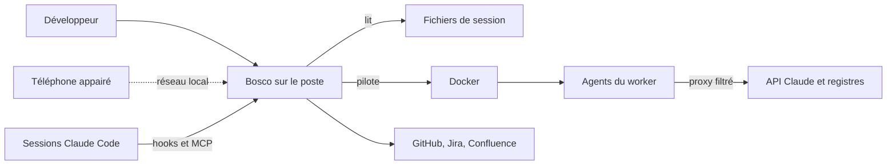
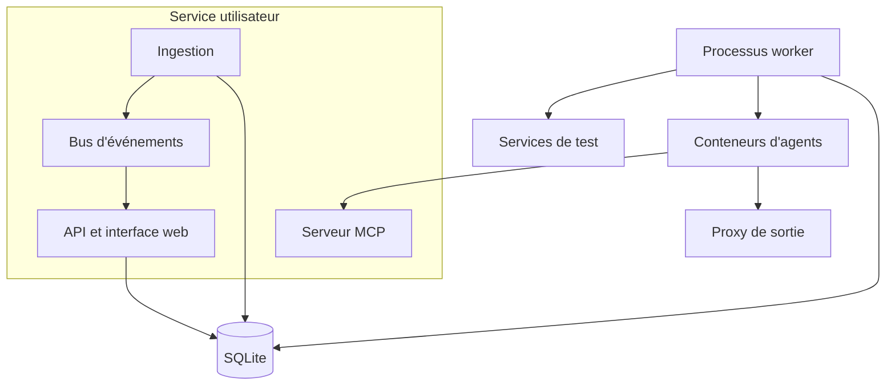
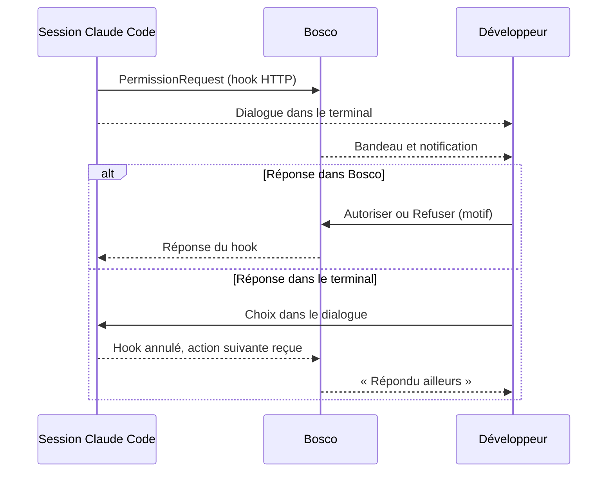
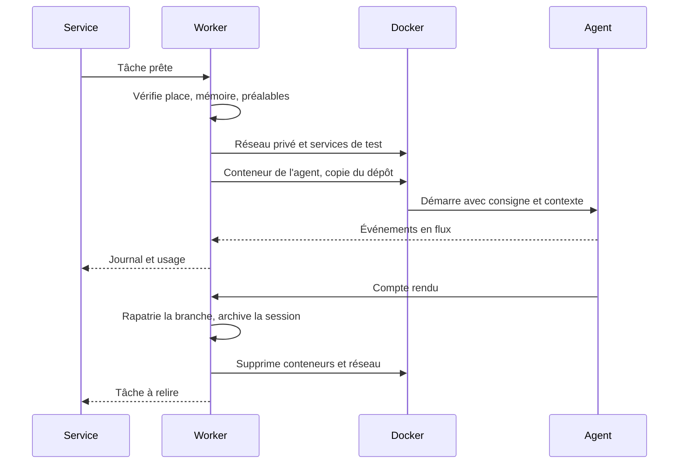
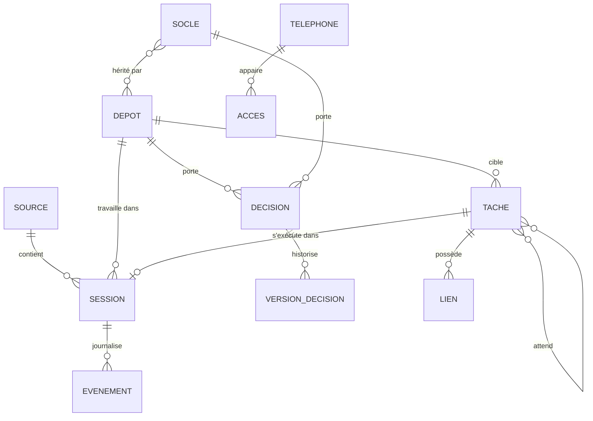

<!-- Généré par export.mjs (skill requirements-doc) depuis sources/60-architecture.md : ne pas modifier ici. -->

# 6. Architecture

## 6.1 Vue d'ensemble

Bosco est une application locale : tout tourne sur le poste. Elle observe les sessions Claude Code, leur répond quand c'est permis, et lance des agents isolés dans Docker.

## 6.2 Composants

Chaque composant suit l'architecture hexagonale (DT-15) : le domaine et ses cas d'usage sont partagés, les composants n'en sont que des adaptateurs. Le service et le worker sont deux processus distincts, qui partagent la même base.

| Composant | Rôle | Lots |
|---|---|---|
| Ingestion | Lit les transcripts, reçoit les hooks, normalise, calcule l'état, copie en base | 1 |
| Bus d'événements | Pousse chaque changement vers les flux SSE | 1 |
| API et interface web | API NestJS (REST, flux SSE), Next.js hébergé dans le même processus, notifications du bureau | 1, 2, 3 |
| Serveur MCP | Tâches pour « Ma session », propositions de décisions | 2, 3 |
| Processus worker | File, dépendances, copie du dépôt, agents, services, rapatriement de branche | 2, 3 |
| Proxy de sortie | Filtre le réseau des agents par nom de domaine | 3 |
| CLI `bosco` | Démarrer, état, `bosco resume` | 1 |

## 6.3 Flux principaux

**Autorisation demandée** ([E2b](lots/sessions.md#e2b), RF-SESS-03). Le dialogue du terminal et le hook démarrent ensemble : la première réponse l'emporte. Comportement vérifié sur Claude Code 2.1.319 dans les deux sens, non documenté.

**Tâche du worker** ([E5b](lots/taches.md#e5b), [E7a](lots/taches.md#e7a), RF-TACH-01).

**Découverte d'une session** (RF-SESS-01). L'ingestion surveille les dossiers de chaque profil et reprend chaque fichier à sa dernière position. Les hooks donnent le temps réel ; les transcripts donnent l'historique et rattrapent ce qui a été manqué.

## 6.4 Modèle de données

Règles d'intégrité tirées des specs :

- une session a un seul état (RF-SESS-02), une tâche aussi (RF-TACH-02) ;
- un événement a un numéro séquentiel et n'est jamais modifié ;
- une dépendance entre tâches ne forme pas de boucle, et un socle n'hérite pas de lui-même ;
- une décision acceptée change par une nouvelle version, jamais en place (RF-CONT-11) ;
- une tâche en mode Ma session n'a pas de garde-fous (RF-TACH-05).

Droits, plafonds et réglages sont stockés par niveau (général, dépôt, tâche) et résolus au lancement.

## 6.5 Intégrations externes

| Service | Usage | Mode | Points d'attention |
|---|---|---|---|
| Claude Code | Observation et réponses | Hooks HTTP, transcripts, MCP | Format de transcript interne, à tester à chaque version |
| Claude Agent SDK | Agents du worker | Bibliothèque, abonnement | Budget estimé, peut être dépassé ; limites partagées avec les sessions |
| GitHub | Liens enrichis | API, jeton | Rafraîchi toutes les heures |
| GitHub CLI | Branches et PR en brouillon | `git`, `gh` du poste | Absent : seule la validation sans pousser reste |
| Jira, Confluence | Liens enrichis | API, jeton | Jeton expiré : lien gardé, marqué non rafraîchi |
| Docker | Agents et services | Socket du poste | Indisponible : les tâches attendent ([E5c](lots/taches.md#e5c)) |
| Registres privés | Images et paquets npm | Identifiants du registre sur le poste | L'agent ne voit qu'un jeton temporaire |

## 6.6 Sécurité applicative

- **Authentification** : aucune sur la boucle locale. Un téléphone s'appaire par code, puis reçoit un jeton révocable (NF-14).
- **Autorisations** : matrice de la partie 2. Une session ou un agent ne peut pas modifier droits, isolation ni décisions acceptées (RF-CONT-02, RF-CONT-09).
- **Hooks** : l'entrée des hooks n'écoute que sur la boucle locale et exige un secret propre à l'installation.
- **Agents du worker** : utilisateur sans droits, capacités retirées, réseau interne, proxy à liste blanche, jeton MCP par tâche révoqué à la fin.
- **Secrets** : stockés hors de la base lisible par les agents, jamais journalisés (NF-15). La copie temporaire de l'accès Claude est lisible par l'agent pendant la tâche (RQ-05).
- **Docker** : le worker pilote Docker, ce qui équivaut à des droits root sur le poste ; il n'expose jamais le socket aux agents.

## 6.7 Conception du domaine

L'architecture hexagonale (DT-15) n'est utile que si le domaine porte vraiment les règles. Cette partie fixe comment le découper et l'écrire ; les règles du code (§7.4) la reprennent pour les agents, et le lint vérifie les frontières (DT-23).

**Contextes.** Tout le code serveur vit dans une seule application, `apps/api`, avec un module par contexte : `src/<contexte>/`, en quatre couches.

- `domain/` : agrégats, objets valeur, événements, erreurs ;
- `application/` : un service par agrégat et `ports.ts` ;
- `infrastructure/` : les adaptateurs des ports (persistance MikroORM, lecture des transcripts, Docker, git, intégrations) ;
- `interface/http/` : contrôleurs, flux en direct, entrée des hooks, schémas de validation.

`<contexte>.module.ts` relie chaque port à son adaptateur, avec les jetons de `<contexte>/tokens.ts`. `src/shared/` est le noyau partagé (erreur de base, horloge, persistance commune), `src/app.module.ts` le point de composition. Le worker (DT-02) est un autre point d'entrée de la même application (`src/main-worker.ts`), lancé dans son propre processus, qui ne charge que les modules dont il a besoin ; la commande `bosco` aussi (`src/cli/main.ts`, déclarée en `bin` du paquet), ce qui lui permet d'appeler directement les cas d'usage (`bosco resume`). Les contrats partagés avec le web (types des vues, nom de l'application) vivent dans `packages/domain`, et nulle part ailleurs.

| Contexte | Agrégats | Règles portées | Lots |
|---|---|---|---|
| `sessions` | Session (avec son journal d'événements) | RF-SESS-01 à RF-SESS-05, RF-SESS-09 à RF-SESS-11 | 1 |
| `devices` | Téléphone appairé | RF-SESS-07 | 1b |
| `tasks` | Tâche | RF-TACH-01 à RF-TACH-04, RF-TACH-06 à RF-TACH-08 | 2 |
| `policies` | Garde-fous (général, dépôt, tâche), isolation, sortie réseau | RF-TACH-05, RF-CONT-06 à RF-CONT-09, RF-CONT-12 | 2 et 3 |
| `knowledge` | Décision (avec ses versions), Socle, Lien | RF-CONT-01 à RF-CONT-05, RF-CONT-10, RF-CONT-11 | 3 |

Un contexte n'importe jamais les classes d'un autre : quand `tasks` a besoin de savoir qu'une session est close, il déclare un port (`SessionStatus`), que le point de composition (`src/app.module.ts`) branche sur le service de `sessions`.

**Agrégats et invariants.** Un agrégat garantit seul ses règles : on le charge, on appelle une méthode métier, on l'enregistre. Ses invariants se testent sans base ni framework.

| Agrégat | Invariants |
|---|---|
| Session | Un seul état à la fois, et seulement les transitions prévues (RF-SESS-02) ; une seule autorisation en attente, tranchée par la première réponse (RF-SESS-03) ; le journal ne fait que s'allonger, numéroté, jamais modifié ; une reprise n'existe que pour une session close (RF-SESS-09). |
| Tâche | Un seul état parmi les neuf de RF-TACH-02, par des transitions nommées (`queue`, `block`, `start`, `submitForReview`, `validate`, `reject`, `fail`, `cancel`, `retry`) ; modifiable seulement avant son départ (RF-TACH-08) ; jamais fusionnée (RF-TACH-06). |
| Graphe des préalables | Service du domaine, car il couvre plusieurs tâches : pas de boucle, pas de préalable déjà en échec, échec en cascade (RF-TACH-03), branche de départ selon RF-TACH-04. |
| Garde-fous | Un niveau inférieur ne peut que resserrer : outils permis, budget et tours d'une tâche jamais au-delà de son dépôt (RF-TACH-05) ; figés au lancement d'une tâche. La résolution est une fonction pure du domaine. |
| Décision | Un agent propose, jamais n'accepte ni ne modifie une décision acceptée (RF-CONT-02) ; une décision acceptée change par une nouvelle version avec une note, les précédentes restent lisibles (RF-CONT-11). |
| Socle | Pas d'héritage de soi-même, même indirect ; « fait exception à » retire une décision du socle pour un seul dépôt (RF-CONT-03). |
| Téléphone appairé | Accès désactivé par défaut, appairage par code puis confirmation sur le poste (RF-SESS-07). |

**Objets valeur.** Immuables, comparés par valeur, valides dès leur création : identifiants (`SessionId`, `TaskId`, `DecisionId`), chemin de dépôt, nom de branche (`bosco/t-<n>-<sujet>`), coût estimé (dollars au tarif public, toujours présenté comme une estimation, RF-SESS-05), consommation de tokens (entrée, sortie, cache), budget, plafond de tours, règle d'outil (`Bash (npm test)`), durée. Aucun identifiant ni montant ne circule en `string` ou `number` nu dans le domaine.

**Événements du domaine.** Un agrégat note ce qui s'est passé (`PermissionRequested`, `PermissionAnswered`, `SessionStateChanged`, `TaskReadyForReview`, `TaskFailed`, `DecisionProposed`, `DecisionAccepted`…) ; le service les publie après l'enregistrement, par le port `EventPublisher`. Le flux SSE (DT-06), les notifications du bureau et le déblocage des tâches suivantes s'y abonnent dans les adaptateurs : le domaine ne connaît ni SSE, ni notifications. À ne pas confondre avec le journal d'événements d'une session, qui est une donnée lue dans les transcripts.

**Ports.** Déclarés par l'application qui en a besoin, nommés par ce qu'ils offrent : dépôts (`SessionRepository`, `TaskRepository`, `DecisionRepository`), `TranscriptReader`, `ContainerRunner`, `GitGateway` (git et GitHub CLI), `LinkPreviewer` (GitHub, Jira, Confluence), `Notifier`, `EventPublisher`, `Clock`, `IdGenerator`. Chaque port a un adaptateur réel dans `apps/*/src/adapters/out` et un adaptateur en mémoire pour les tests du domaine.

**Cas d'usage et nommage.** Un service par agrégat (`session.service.ts`), une méthode par intention (`askPermission`, `answerPermission`, `queueTask`, `validateTask`, `acceptDecision`), jamais `execute`, `handle` ni `run`. `get…` lève une erreur si l'objet manque, `find…` renvoie `null` ; `list…`, `count…`, `has…`. Une méthode de contrôleur porte le nom de la méthode du service qu'elle appelle ; une dépendance injectée porte le nom de son type.

**Erreurs.** Une erreur du domaine hérite de l'erreur de base de son contexte et porte un code stable en camelCase (`permissionAlreadyPending`, `taskNotFound`) et un message en anglais. L'adaptateur HTTP les traduit en statut et en corps `{ statusCode, code, message }` ; l'interface traduit le code et n'affiche jamais le message. Un 5xx ne renvoie aucun détail interne.

**Assemblage.** Chaque `<contexte>.module.ts` relie ses ports à leurs adaptateurs (fabriques `useFactory` et jetons `Symbol`), avec des remplacements possibles pour les tests ; `src/app.module.ts` assemble les contextes et câble ce qui les croise. Le mapping MikroORM vit dans les adaptateurs (`EntitySchema` ou `defineEntity`, DT-18) : les classes du domaine restent sans décorateur.

## 6.8 Anti-patterns à éviter

| Anti-pattern | À quoi on le reconnaît | À faire |
|---|---|---|
| Domaine anémique | Classes à propriétés publiques modifiées par les services ; règles dans les cas d'usage | Méthodes métier sur l'agrégat (`session.askPermission(at)`) qui protègent ses invariants |
| Framework dans le domaine | Import de `@nestjs/*`, `@mikro-orm/*`, `rxjs`, `node:fs`… dans `domain/` ou `application/` ; décorateurs sur les entités | Un port dans l'application, l'adaptateur dans `infrastructure/` ; refusé par le lint |
| Logique dans un adaptateur | Règle métier dans un contrôleur, le flux SSE, un hook ou un adaptateur de dépôt | L'adaptateur traduit et délègue au cas d'usage |
| Fuite de l'ORM | Un dépôt renvoie une entité MikroORM, un `QueryBuilder` ou une ligne brute | Le dépôt renvoie des objets du domaine |
| Temps et hasard implicites | `new Date()`, `Date.now()`, `randomUUID()` dans le domaine | Ports `Clock` et `IdGenerator`, horloge fixe dans les tests |
| Obsession des primitifs | `sessionId: string`, `cost: number` qui traversent les couches | Objets valeur |
| Couplage entre contextes | `tasks` importe la classe `Session` | Un port déclaré par `tasks`, branché à l'assemblage ; refusé par le lint |
| Cas d'usage générique | `execute(command)`, `handle(input)`, un service fourre-tout | Une méthode par intention, un service par agrégat |
| Paquet partagé sans second utilisateur | `packages/utils` pour une seule application | Le code reste dans l'application tant qu'il n'a qu'un utilisateur |
| Tests en double | Un test unitaire qui rejoue un scénario Gherkin | Un parcours se teste une fois, en scénario ; Vitest couvre ce que les scénarios n'atteignent pas (temps, cas rares, invariants) |
| Cérémonie DDD | Event sourcing, CQRS, bus de commandes, dépôt générique, couches de conversion sans règle | Bosco est un outil de poste : SQLite, agrégats simples, événements publiés après l'enregistrement |

## 6.9 Décisions d'architecture

**DT-01 · Dépôt dédié.** Bosco vit dans son propre dépôt, avec les specs. Écarté : rester avec les POC.

**DT-02 · Service et worker séparés.** Redémarrer l'interface ne coupe pas les tâches (NF-07). Deux processus, coordonnés par la base, lancés depuis la même application serveur (`main.ts` et `main-worker.ts`, DT-15). Écarté : un seul processus.

**DT-03 · Worker écrit à neuf.** Le code est écrit pour ce modèle de données, sans reprise. Coût : lot 2 plus long.

**DT-04 · SQLite local.** Mode WAL pour deux processus, FTS5 pour la recherche. Aucun service à installer. Écarté : base serveur, disproportionnée sur un poste.

**DT-05 · Hooks et transcripts.** Les hooks HTTP donnent le temps réel, les transcripts l'historique. Claude Code [précise](https://code.claude.com/docs/en/sessions.md) que leur format est interne : la lecture tolère l'inconnu (NF-08).

**DT-06 · SSE et bus en mémoire.** Un flux global et un flux par session, poussés à l'ingestion. Chaque flux commence par un instantané de l'état, puis envoie les changements, sur le même canal : la lecture de l'instantané et l'abonnement ont lieu dans le même tour de boucle, si bien qu'aucun changement ne peut se perdre entre les deux. L'essai de DT-21 l'a montré : avec une lecture REST séparée du flux, un changement reçu pendant la première lecture était perdu (2 échecs sur 12 passages d'un même scénario) ; avec l'instantané, 24 passages sur 24. Une reconnexion reçoit un nouvel instantané. Écartés : interrogation périodique (coûteuse), WebSocket (le trafic va surtout du serveur au client).

**DT-07 · Autorisations par hook `PermissionRequest`.** Fondé sur un comportement testé mais non documenté, d'où NF-09 et RQ-01.

**DT-08 · Conteneur jetable et services de test.** Docker natif, sans publication de ports, donc sans conflit entre tâches. Écartés : bac à sable bubblewrap (bloqué par AppArmor sur Ubuntu 24.04, sans accès aux services), sans isolation, Sysbox (inutile : un seul dépôt personnel lance Docker dans ses tests).

**DT-09 · Abonnement Claude pour le worker.** Décision du porteur du projet. Écarté : clé d'API. Conséquence : limites partagées avec les sessions (RQ-04).

**DT-10 · Téléphone sur le réseau local.** Certificat créé par Bosco, avertissement accepté une fois, appairage par code, sans VPN. Conséquence : pas d'accès hors réseau, pas de notifications sur le téléphone.

**DT-07 (précision).** Le hook attend 10 minutes, sa valeur par défaut. Au-delà, les boutons disparaissent de Bosco et le dialogue reste dans le terminal.

**DT-11 · Pull requests par `git` et `gh`.** Aucun jeton supplémentaire : Bosco utilise ceux du poste.

**DT-12 · API en NestJS.** Choix du porteur du projet : c'est la stack des API existantes. Le serveur MCP et le worker utilisent la même structure de modules. Conséquence : plus de mémoire au repos qu'avec Fastify seul (NF-04).

**DT-13 · Web en Next.js, hébergé par NestJS.** Choix du porteur du projet. NestJS sert Next.js dans son propre processus (serveur personnalisé) : un seul service et un seul port, sans proxy, avec le certificat du téléphone géré à un seul endroit. Les flux SSE sont servis par NestJS. Vérifié par l'essai de DT-21 : Next.js 16.4 servi par NestJS 12.4 avec l'adaptateur Fastify, sur un seul port, les routes de l'API passant avant celles de Next.js ; `next` est un module CommonJS, son export par défaut se récupère explicitement sous `nodenext`. Écartés : Next.js en processus séparé (un service de plus à superviser), export statique (les pages à identifiant dynamique, comme une session, s'y prêtent mal).

**DT-14 · MikroORM.** Choix du porteur du projet. Pilote SQLite, unité de travail, migrations versionnées. La recherche plein texte (FTS5) passe par des requêtes natives dans l'adaptateur. Écartés : Drizzle, Prisma, TypeORM.

**DT-15 · Architecture hexagonale par modules.** Choix du porteur du projet. Une seule application serveur, `apps/api`, avec un module par contexte métier et ses quatre couches (`domain`, `application`, `infrastructure`, `interface/http`, §6.7) ; le domaine et l'application restent sans dépendance technique ; NestJS, MikroORM, Docker et les intégrations sont des adaptateurs derrière des ports. Conséquence : un peu plus de code d'assemblage, en échange de tests du domaine rapides et sans infrastructure. Écarté : un paquet `packages/core` pour le domaine, partagé par l'API et le worker (un paquet à compiler avant l'API, trois couches réparties entre deux dossiers, pour un worker qui peut être un second point d'entrée de la même application).

**DT-16 · TypeScript 6 et ESM.** Choix du porteur du projet. TypeScript 6.0, dernière version de la branche 6, pour tout le code, en modules ESM ; les tests passent par Vitest, sans Jest. NestJS et MikroORM s'appuient sur les métadonnées des décorateurs (voir DT-18). Le passage à TypeScript 7 est prévu dès que l'outillage le permet (DT-20).

**DT-17 · Données et état côté web.** Choix du porteur du projet. TanStack Query porte tout ce qui vient du serveur : le cache des vues en direct est rempli par le flux (instantané puis changements, DT-06), celui des autres écrans par l'API REST ; il n'y a pas de second état à synchroniser. Zustand ne garde que l'état de l'interface (regroupement par dépôt ou par état, filtres, panneaux ouverts) ; le regroupement choisi est conservé d'une visite à l'autre (RF-SESS-06). Les formulaires passent par React Hook Form et son résolveur zod : valeurs, erreurs par champ et soumission, et les erreurs renvoyées par l'API se posent sur leur champ. Écartés : Redux (lourd pour ce besoin), Context React seul (rendus en cascade sur un écran mis à jour en direct), formulaires tenus à la main dans l'état local.

**DT-18 · TypeScript 6 seul pour compiler et vérifier.** Choix du porteur du projet : un seul compilateur à régler. `tsc -b` compile l'application serveur (service, worker, commande `bosco`) et les paquets en ESM (`module` et `moduleResolution` à `nodenext`), avec `experimentalDecorators`, `emitDecoratorMetadata` et un `rootDir` explicite. Next.js compile lui-même le web et vérifie ses types avec TypeScript 6 ; il exige `@types/node`. Vitest transforme les tests avec son outil intégré : les décorateurs « legacy » et leurs métadonnées y sont réglés explicitement dans `vitest.config` (`oxc.decorator`), sans dépendre d'un réglage par défaut. Pour garder le passage à TypeScript 7 simple (DT-20), la compilation passe par `tsc` et non par la CLI NestJS, et le mapping MikroORM est explicite (`EntitySchema` ou `defineEntity`), sans lecture des types. Essai du 07/11/2026 dans un monorepo pnpm 12.18, tout vert, avec Node 26.13 LTS, TypeScript 6.0.3, NestJS 12.4.0, MikroORM 7.2.8 sur SQLite, Vitest 5.1.0, Next.js 16.4.5, React 19.3, TanStack Query 5.107 et Zustand 5.1 : vérification de types, injection NestJS et lecture d'une entité du domaine par MikroORM après compilation par `tsc` et sous Vitest, build Next.js qui détecte bien une erreur de type. La même configuration passe aussi `tsc --noEmit` de TypeScript 7.0.2, pour l'API comme pour le web.

**DT-19 · ESLint et Prettier.** Choix du porteur du projet, dernières versions : ESLint 10 en configuration plate, typescript-eslint 8.72 avec règles typées (`recommendedTypeChecked`, `projectService`), `@next/eslint-plugin-next` pour le web (réglage `settings.next.rootDir` sur `apps/web` dans le monorepo), Prettier 3.9 et `eslint-config-prettier` pour qu'ESLint ne juge pas la mise en forme. Essai du 07/11/2026 avec TypeScript 6.0.3 : ESLint passe sur le code propre, signale une promesse non attendue (règle typée) et une balise `` (règle Next.js) ; Prettier signale un fichier mal formé et accepte le reste. Écartés : oxlint, Biome.

**DT-20 · Passage à TypeScript 7.** Prévu, pas encore possible : TypeScript 7 n'a plus l'API JavaScript du compilateur, et typescript-eslint, qui en dépend, n'accepte TypeScript que jusqu'à la 6.0 (8.72.1, 26/10/2026). La nouvelle API arrive avec TypeScript 7.1 (beta du 20/10/2026) et sa prise en charge par typescript-eslint est en cours. Déclencheur : une version stable de typescript-eslint qui accepte TypeScript 7.1, vérifiée au démarrage de chaque lot. D'ici là, le projet compile et se vérifie en TypeScript 6 seul ; la CI ne lance pas TypeScript 7. Passage : monter `typescript`, puis rejouer typage, tests, ESLint et build Next.js ; c'est une tâche à part, hors des lots, estimée à moins d'une demi-journée de relecture.

**DT-21 · Stratégie de tests.** Choix du porteur du projet, après un essai complet le 07/11/2026.

- **Deux outils, un rôle chacun.** Vitest teste le domaine, les cas d'usage et les adaptateurs (MikroORM sur SQLite, lecture des transcripts, Docker). playwright-bdd 9.2, sur Playwright 1.65, joue les scénarios Gherkin.
- **Deux suites séparées, lancées l'une sans l'autre.** `e2e/api`, sans navigateur, et `e2e/web`, en deux groupes : `desktop` et `mobile` (scénarios tagués `@mobile`, profil Pixel 7). Chaque suite a sa configuration, ses phrases, ses données d'exemple, ses enregistrements et son rapport Cucumber. Elles ne partagent que le lancement de Bosco (`e2e/shared`) et le module d'enregistrement.
- **Deux styles de scénarios.** Ceux de l'API sont techniques et en anglais : route, code de réponse, JSON, événement du flux. Des phrases génériques les rendent presque gratuits à écrire : requête HTTP, requête restée en attente (hook), événement attendu sur le flux, capture d'une réponse avec des champs masqués, transcript d'exemple. Ceux du web sont des parcours en français, avec des phrases d'interface par rôle accessible (« je clique sur le bouton « Autoriser » »), les textes entre guillemets français, et la phrase « la page est accessible » (axe, WCAG 2.2 AA). La langue est celle de la suite. L'anglais, langue par défaut de Gherkin, ne demande rien. Les fichiers du web commencent par `# language: fr`, car le plugin Prettier et l'extension Cucumber de l'éditeur ne lisent la langue que là.
- **Une instance de Bosco par processus de test**, avec son port, son dossier Claude Code et sa base, remise à zéro entre deux scénarios par une route réservée aux tests (absente hors mode test). Les scénarios tournent en parallèle, sans données partagées.
- **Enregistrer, rejouer, nettoyer.** Un module du dépôt, d'environ 200 lignes, s'appuie sur `Agent` et `MockAgent` d'undici. Il est chargé par `node --import` dans le processus testé seulement : le code de l'application garde `fetch`. Modes : `replay` (par défaut et en CI : tout vient des fichiers, une requête inconnue échoue), `record` (rejoue l'existant, enregistre ce qui manque, sur le poste avec les vrais accès), `update` (réenregistre tout), `clean` (supprime ce qu'aucun processus de test n'a utilisé, rapports réunis à la fin). Un fichier JSON lisible par réponse, rangé par hôte dans le dossier de la suite ; le corps de la requête choisit la réponse ; les réponses successives se rejouent dans l'ordre ; en-têtes en liste blanche et secrets masqués à l'enregistrement, puis recherchés en CI. Dans le navigateur, les écrans sans temps réel rejouent les réponses de l'API de Bosco par `page.route`, avec le même format. Les transcripts et requêtes de hooks Claude Code suivent la même logique : enregistrés depuis de vraies sessions, anonymisés, rangés par version de Claude Code.
- **Qualité des `.feature`.** `prettier-plugin-gherkin` 4.0 les met en forme (indentation, tableaux alignés) dans le `prettier --check` habituel. Un contrôle du dépôt, d'environ 60 lignes sur le parseur officiel `@cucumber/gherkin`, vérifie le sens : langue de la suite (en-tête `# language: fr` pour le web, aucun pour l'API), tag de critère `@CA-…`, `@RF-…` ou `@NF-…` sur chaque scénario ou sa fonctionnalité, une action et un résultat par scénario, contexte seul dans `Contexte`, 15 scénarios au plus par fichier, noms uniques, description de la fonctionnalité.
- **Ce qui est versionné** : les `.feature`, les phrases, les captures (dans un dossier `__snapshots__` à côté des features, sans suffixe de plateforme) et les enregistrements. **Ce qui ne l'est pas** : `.features-gen/`, généré par `bddgen` à chaque lancement, les rapports et `test-results/`.
- **Tests réels** tagués `@reel`, exclus par défaut et lancés à la demande sur le poste : NF-09 (vraie session Claude Code), NF-11 (évasion d'un vrai conteneur), NF-12 (arrêt brutal du worker).
- **Répartition des critères.** Une règle du domaine se teste avec Vitest ; un contrat d'API (route, code, JSON, événement, hook) par un scénario `api` ; un parcours ou un état visible par un scénario web. La répartition critère par critère se fait en écrivant les tests, et `trace.mjs` la mesure : il lit les tags des `.feature` comme les noms des tests Vitest.
- **Points relevés par l'essai.** Une phrase ne se déclare qu'une fois : playwright-bdd ne distingue pas « Étant donné », « Quand » et « Alors ». Le plugin Prettier des `.feature` analyse en anglais tout fichier sans en-tête de langue. Un enregistrement manquant échoue avec un message d'undici peu parlant : le module devra nommer la requête et la commande à lancer. Deux enregistrements de la même requête se masquent l'un l'autre, et le nettoyage peut garder la copie plutôt que l'original : le module devra refuser les doublons au chargement.
- **Résultat de l'essai** (Node 26.13, TypeScript 6.0.3, pnpm 12.18) : 9 scénarios et 6 tests du module d'enregistrement. Sur 5 répétitions, chaque suite lancée seule : API, 25 passages sur 25 en 4,1 s ; web (4 scénarios, dont un sur mobile), 20 sur 20 en 4,3 s. Rejeu sans réseau, enregistrement contre la vraie API GitHub, nettoyage dans chaque suite du fichier devenu inutile ; 7 fautes relevées sur un fichier fautif ; une vraie violation d'accessibilité trouvée par axe (titre de page manquant) ; et la perte d'événement corrigée par DT-06.

Écartés : une configuration Playwright commune à l'API et au web (couplage inutile entre deux suites qui ne tournent pas ensemble) ; Cucumber sous Vitest pour l'API (deux exécuteurs Gherkin avec le web) ; gherklin (publié en TypeScript non compilé, il exige tsx, et ses règles génériques relèvent de la mise en forme, déjà assurée par Prettier) ; `SnapshotAgent` d'undici (expérimental, corps enregistrés en base64, ce qui cache les secrets aux contrôles) ; rejeu par fichier HAR de Playwright (il compare l'URL avec son port, alors que chaque processus de test a le sien, et ne signale pas les réponses inutilisées).

**DT-22 · Turborepo sur pnpm.** Choix du porteur du projet. Turborepo 2.11 (2.11.10) orchestre les tâches du monorepo pnpm : `build`, `typecheck`, `lint`, `test`, `lint:features`, `e2e:api` et `e2e:web`. Il ne remplace aucun outil : `tsc -b` compile toujours (DT-18), Next.js construit le web, Vitest et playwright-bdd testent.

- **Ordre et parallélisme.** Chaque tâche dépend des `build` des paquets dont elle dépend (`dependsOn: ["^build"]`) ; le reste tourne en parallèle. Le paquet des scénarios déclare l'API et le web en dépendances (`workspace:*`), pour qu'ils soient construits avant.
- **Cache local.** Une tâche dont les entrées n'ont pas changé rejoue son résultat et ses journaux sans s'exécuter. Les entrées suivent git : le `.gitignore` doit exclure tout ce qui est généré (`dist/`, `.next/`, `next-env.d.ts`, `*.tsbuildinfo`, `.turbo/`, `.features-gen/`, rapports, `test-results/`), sinon le cache ne tient jamais. Sorties déclarées : `dist/**`, `.next/**` sans `.next/cache`, rapports des suites.
- **Deux suites, deux entrées.** Les entrées de `e2e:api` excluent le dossier du web, et inversement : modifier un scénario du web ne relance pas la suite de l'API. Le dossier commun (`e2e/shared`) relance les deux. Le mode d'enregistrement (`BOSCO_REPLAY`) fait partie de l'empreinte.
- **Enregistrer et nettoyer hors cache.** Les modes `record`, `update` et `clean` écrivent des fichiers : leurs commandes passent `--force` (`pnpm e2e:api:record`, `pnpm e2e:web:record`, `pnpm e2e:clean`).
- **CI.** Les étapes passent par `turbo run` ; le dossier de cache de Turborepo est conservé entre deux exécutions par le cache de GitHub Actions.
- **Essai du 07/11/2026** (Node 26.13, pnpm 12.18) : premier lancement de `e2e:api` en 4 s (API, web, scénarios) ; second lancement entièrement en cache, en 10 ms ; `e2e:web` réutilise les builds déjà en cache ; une modification d'un scénario web ne relance que `e2e:web` ; une modification du code de l'API relance son build et `e2e:api`, pas celui du web. Sans `.gitignore`, chaque lancement reconstruisait tout.

Écartés : cache distant (un seul poste, la CI se suffit du cache local), Nx (plus lourd à régler pour cinq paquets), scripts pnpm seuls (`pnpm -r` ne sait ni éviter une tâche inchangée ni rejouer un résultat).

**DT-23 · Qualité du code partagée et frontières vérifiées.** Choix du porteur du projet. Un paquet `packages/configs` porte toutes les configurations (§7.3) : TypeScript, ESLint, Vitest et Prettier. Chaque paquet les étend en quelques lignes, et aucune règle ne se désactive dans le code. Les frontières de l'architecture hexagonale (§6.7) sont des règles ESLint de l'application serveur (`eslint/nest`), et non une convention écrite.

- **Essai du 07/11/2026** (ESLint 10.14, typescript-eslint 8.72.1, eslint-plugin-boundaries 7.4.2, TypeScript 6.0.3) : un domaine à deux contextes passe le lint, le typage et ses tests. Cinq violations écrites exprès sont refusées, chacune avec un message qui dit quoi faire : `@mikro-orm/core` dans le domaine, domaine qui importe l'application, contexte qui importe un autre contexte, `node:fs` dans l'application, fichier hors kebab-case. Sur le code de l'essai, écrit sans ces règles, le lint a relevé 46 défauts : 25 corrigés automatiquement, 21 à la main (expressions régulières à risque, valeurs `any`, méthode détachée de son objet, comparaison toujours fausse). Les 14 tâches `lint`, `typecheck`, `test` et `build` et les deux suites e2e passent ensuite.
- **Points relevés** :
  - `eslint-plugin-jsx-a11y` (6.10.2, octobre 2024) déclare ESLint 9 au plus. Il fonctionne avec ESLint 10, mais pnpm le signale (RQ-11).
  - Les motifs ignorés doivent commencer par `**/`, sinon les dossiers générés des sous-dossiers (`api/.features-gen`) sont analysés.
  - Le greffon Gherkin de Prettier se résout depuis `packages/configs`, pour que la racine n'ait pas à le déclarer.
  - Une fixture Playwright sans dépendance (`async ({}, use)`) demande l'option `allowObjectPatternsAsParameters` de `no-empty-pattern`, plutôt qu'un commentaire de désactivation.

Écartés : `dependency-cruiser` (un outil de plus, alors qu'ESLint lit déjà les imports), Biome et oxlint (DT-19), une configuration par application (des règles qui dérivent d'une application à l'autre).

**DT-24 · Règles pour les agents dans le dépôt.** Choix du porteur du projet. Claude Code écrit le code : les conventions sont des fichiers du dépôt, qu'il charge seul (§7.4). On y trouve `AGENTS.md` (lié à `CLAUDE.md`), des règles par zone dans `.claude/rules/` (en-tête `paths:`), un sous-agent qui confronte le code aux specs en fin de lot, et une liste de contrôles avant de rendre la main. Ce qu'une règle peut vérifier passe par le lint ; le texte garde ce que le lint ne voit pas, comme le nommage par intention, les anti-patterns de §6.8 ou ce que teste chaque niveau. Écarté : une documentation de conventions hors du dépôt, que l'agent ne lirait pas.

**DT-25 · daisyUI sur les tokens.** Choix du porteur du projet. Les maquettes et l'application emploient les classes de daisyUI 5.7.50 (`btn btn-primary`, `badge`, `input`, `toggle`, `modal`…), plutôt que des suites d'utilitaires qui les imitent. Un thème daisyUI pointé sur les tokens des specs règle leur rendu : l'identité « Atelier clair » ne change pas, et une couleur se change toujours dans les tokens, sans `data-theme` ni thème intégré. Les composants React (shadcn/ui sur Radix, pour les comportements clavier et l'accessibilité) posent ces classes par leurs variantes ; le skill `design-system` met le tout en place au lot 0 (`scaffold.mjs --specs`, copie des tokens par `tokens.mjs`), avec Storybook et le lint des classes. Les specs ont été migrées le 07/11/2026 : 180 boutons, 143 badges, 31 champs, 12 cases, 10 interrupteurs, 10 tableaux, 8 fenêtres, sans débordement relevé. shadcn/ui sur Radix et Storybook validés par le porteur du projet le 07/11/2026. Écartés : composants de daisyUI seuls (pas de gestion du clavier ni du focus des fenêtres et menus), classes maison.

**DT-26 · Fil complet d'une session.** Choix du porteur du projet (08/11/2026). Le détail d'une session (E2a) montre sa conversation complète, lue à la demande dans son transcript : le journal enregistré garde l'essentiel (recherche, résumé), le transcript reste la source du détail et n'est jamais recopié. La lecture tolère l'inconnu (DT-05, NF-08) ; une très longue session n'est lue que par sa fin (8 Mo), puis seules les lignes ajoutées sont relues ; un transcript effacé par Claude Code laisse le fil résumé du journal. Le rendu suit les patterns d'AI Elements de shadcn/ui (Reasoning, Tool, Terminal, Test Results, Stack Trace, Task), assemblés sur les composants `trace`, `code-block`, `message` et `bubble` rangés sous les classes du projet (DT-25) ; les réponses en Markdown passent par Streamdown, le code par Shiki (thèmes GitHub à contraste élevé, AA sur les lignes de diff).
