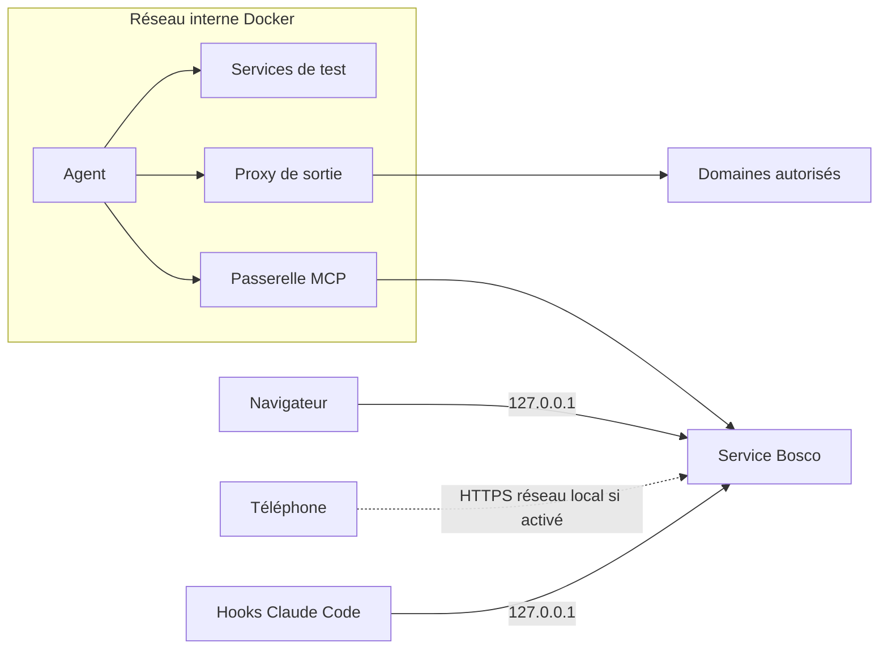

<!-- Généré par export.mjs (skill requirements-doc) depuis sources/80-infrastructure.md : ne pas modifier ici. -->

# 8. Infrastructure et exploitation

## 8.1 Hébergement

Aucun hébergement : Bosco tourne sur le poste de l'utilisateur, Ubuntu 24.04, Docker natif. Les données restent sur le poste (NF-16).

## 8.2 Environnements

| Environnement | Usage | Données | Déploiement |
|---|---|---|---|
| Développement | Écrire et tester | Fixtures, sessions de test | `pnpm dev` |
| Poste | Usage réel | Sessions réelles, `~/.local/share/bosco` | Service utilisateur systemd, ou application du poste installée par son paquet .deb (DT-33) |

## 8.3 Topologie et réseau

Le service écoute sur `127.0.0.1`. Comme un conteneur ne joint pas la boucle locale du poste, une passerelle sur le réseau interne relaie le MCP vers le service. L'écoute sur le réseau local n'existe que si l'accès téléphone est activé (NF-13).

Le service NestJS porte l'API, les flux SSE, Next.js et l'écoute HTTPS du téléphone, sur un seul port.

## 8.4 Conteneurs et exécution

- **Image de l'agent** : `bosco-agent`, construite localement au premier usage : Claude Code, git, Node, Python, ripgrep. Une image par dépôt est possible ([E12a](lots/contexte.md#e12a)).
- **Limites** : 4 Go de mémoire, 2 processeurs, 512 processus par agent ; 1 Go et 1 processeur par service.
- **Capacité** : 4 agents au plus, 4 Go de mémoire gardés libres.
- **Nettoyage** : à la fin de chaque tâche, puis au démarrage du worker pour les restes (NF-12).

## 8.5 CI/CD

GitHub Actions à chaque push, chaque étape par `turbo run` avec le cache de Turborepo conservé entre deux exécutions (DT-22) : ESLint, `prettier --check` (code et `.feature`), contrôle des `.feature`, typage par `tsc -b` (TypeScript 6), tests Vitest, build, les deux suites Gherkin (API, puis web) en mode `replay`, recherche de secrets dans les enregistrements. Aucun déploiement : l'installation se fait sur le poste, depuis le dépôt. Travail sur branches, relecture humaine avant fusion. Retour arrière : réinstaller la version précédente ; les migrations de base sont additives.

## 8.6 Configuration, secrets et infrastructure as code

Configuration dans `~/.config/bosco/`, droits `600`. Jetons d'intégration dans le trousseau du système si disponible, sinon dans ce dossier. Pas d'IaC : un script d'installation crée le service utilisateur.

## 8.7 Observabilité

Journaux structurés via journald (`journalctl --user -u bosco`). Page Sources : état de chaque source, dernier signal, version de Claude Code. Compteur de lignes de transcript ignorées (NF-08). Pas de métriques externes.

## 8.8 Sauvegardes et reprise

La base contient la seule copie des sessions effacées par Claude Code (NF-17). Copie quotidienne de la base, 7 jours conservés, dans `~/.local/share/bosco/backups`, à inclure dans la sauvegarde du poste.

## 8.9 Sécurité de l'infrastructure

Exigences NF-11 à NF-16. Agents sans droits, `no-new-privileges`, capacités retirées. Dépendances analysées en CI (`pnpm audit`). Versions d'images figées.

## 8.10 Coûts estimés

Aucun coût d'hébergement. Le worker consomme l'abonnement Claude existant, sans facturation supplémentaire, dans ses limites.
